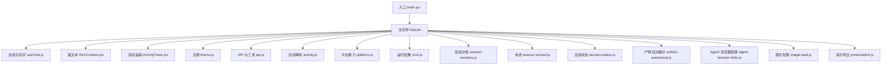
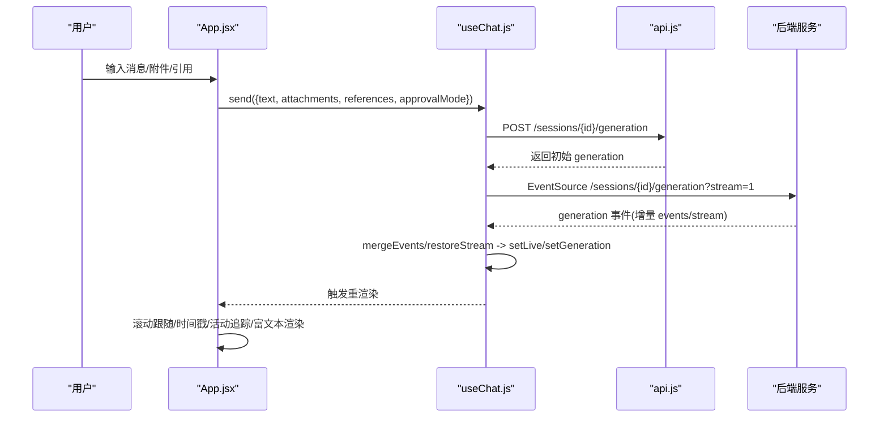
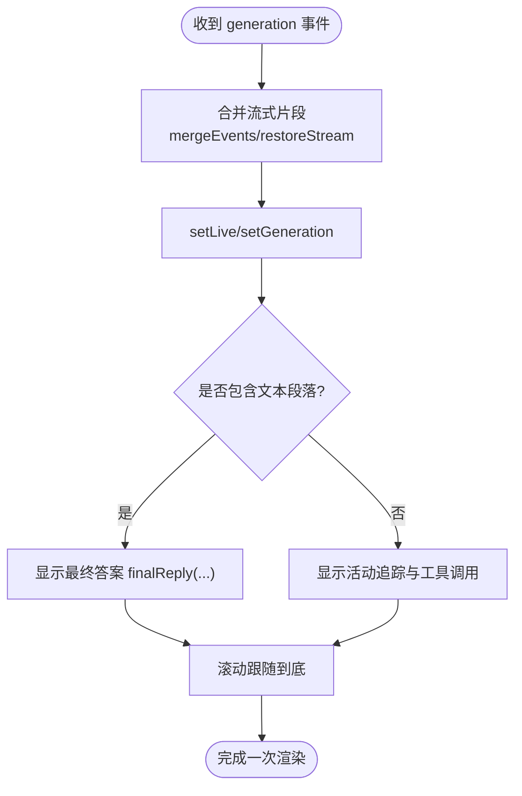
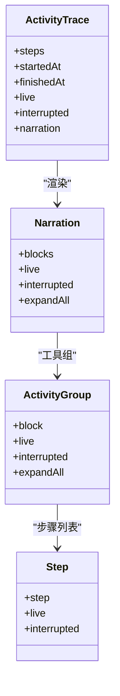
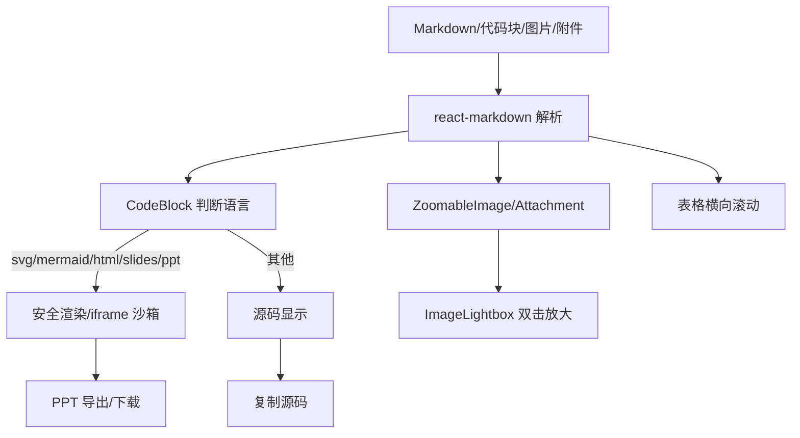
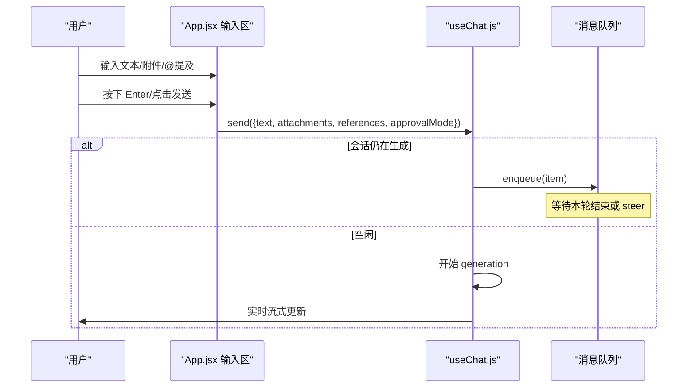
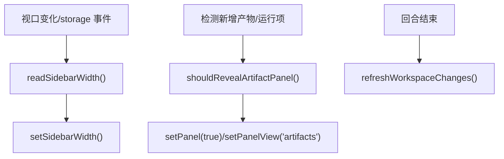
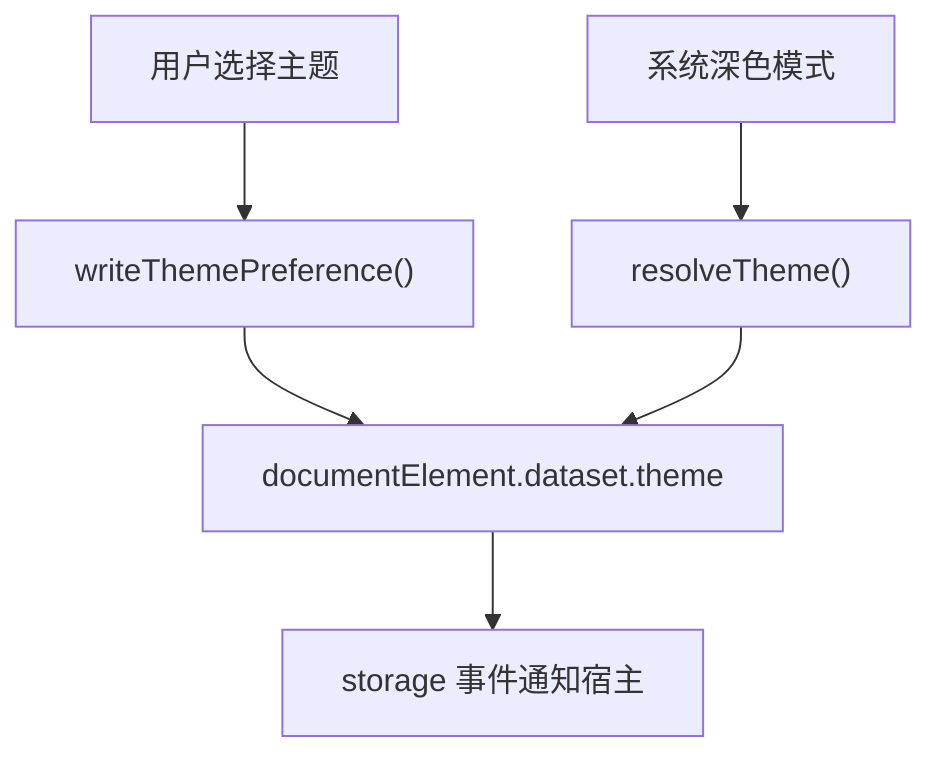
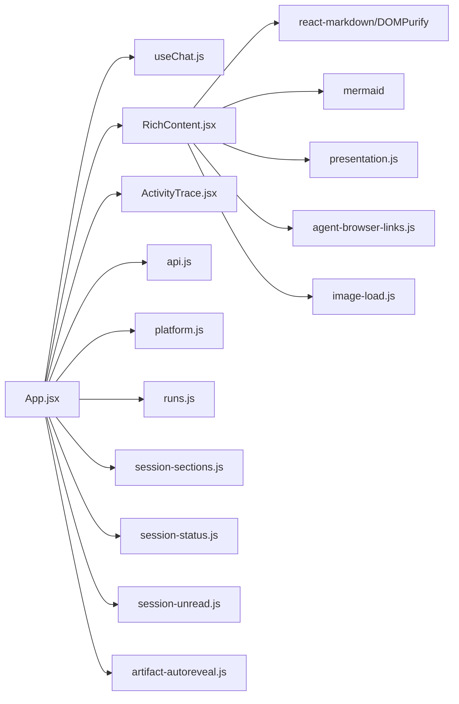

# 用户界面交互

<cite>
**本文引用的文件**   
- [main.jsx](file://chatbot/src/main.jsx)
- [App.jsx](file://chatbot/src/App.jsx)
- [useChat.js](file://chatbot/src/useChat.js)
- [RichContent.jsx](file://chatbot/src/RichContent.jsx)
- [ActivityTrace.jsx](file://chatbot/src/ActivityTrace.jsx)
- [theme.js](file://chatbot/src/theme.js)
- [message-info.js](file://chatbot/src/message-info.js)
- [api.js](file://chatbot/src/api.js)
- [activity.js](file://chatbot/src/activity.js)
- [session-status.js](file://chatbot/src/session-status.js)
- [session-unread.js](file://chatbot/src/session-unread.js)
- [session-sections.js](file://chatbot/src/session-sections.js)
- [artifact-autoreveal.js](file://chatbot/src/artifact-autoreveal.js)
- [platform.js](file://chatbot/src/platform.js)
- [runs.js](file://chatbot/src/runs.js)
- [agent-browser-links.js](file://chatbot/src/agent-browser-links.js)
- [image-load.js](file://chatbot/src/image-load.js)
- [presentation.js](file://chatbot/src/presentation.js)
- [styles.css](file://chatbot/src/styles.css)
</cite>

## 目录
1. [简介](#简介)
2. [项目结构](#项目结构)
3. [核心组件](#核心组件)
4. [架构总览](#架构总览)
5. [详细组件分析](#详细组件分析)
6. [依赖关系分析](#依赖关系分析)
7. [性能与体验特性](#性能与体验特性)
8. [故障排查指南](#故障排查指南)
9. [结论](#结论)

## 简介
本文面向 LoopForge 聊天界面的前端实现，聚焦 React 聊天 UI 的组件结构、消息渲染与实时更新机制，并说明活动追踪显示、富文本内容处理、附件预览、用户输入处理、键盘快捷键、响应式布局、主题配置与可访问性支持。文档同时给出架构图、时序图与流程图，帮助读者从整体到细节理解系统行为。

## 项目结构
聊天界面以 `chatbot/src` 为根目录，采用“功能 + 视图”混合组织方式：
- 入口与全局边界：`main.jsx` 负责挂载 React 应用与错误边界。
- 主应用容器：`App.jsx` 聚合会话状态、侧边栏、面板、对话框、主题、快捷操作等。
- 会话与实时数据：`useChat.js` 提供会话、模型、执行器、流式生成、队列、轮询与 SSE 连接等能力。
- 内容渲染：`RichContent.jsx` 负责 Markdown、代码块、图表、幻灯片、图片与产物预览。
- 活动追踪：`ActivityTrace.jsx` 将工具调用、思考、命令等步骤可视化。
- 主题与样式：`theme.js` 管理主题偏好；大量 CSS 文件控制响应式与动效。

**图示来源**
- [main.jsx:32-36](file://chatbot/src/main.jsx#L32-L36)
- [App.jsx:1-92](file://chatbot/src/App.jsx#L1-L92)
- [useChat.js:105-151](file://chatbot/src/useChat.js#L105-L151)
- [RichContent.jsx:351-365](file://chatbot/src/RichContent.jsx#L351-L365)
- [ActivityTrace.jsx:316-399](file://chatbot/src/ActivityTrace.jsx#L316-L399)
- [theme.js:1-38](file://chatbot/src/theme.js#L1-L38)

**章节来源**
- [main.jsx:1-37](file://chatbot/src/main.jsx#L1-L37)
- [App.jsx:1-92](file://chatbot/src/App.jsx#L1-L92)

## 核心组件
- 应用容器 App.jsx：维护会话、项目、模型、执行器、侧边栏宽度、面板、对话框、草稿、附件、引用、主题、环境可见性等状态；统一处理发送、快捷键、滚动跟随、产物自动展开、工作区变更刷新等。
- 会话 Hook useChat.js：封装认证、项目、模型、会话列表、当前会话、流式事件、SSE 与轮询、队列、引导（steer）、错误恢复、跨窗口通信等。
- 富文本 RichContent.jsx：基于 react-markdown 渲染 Markdown/GFM，自定义代码块、SVG、Mermaid、HTML 预览、幻灯片、图片放大、附件卡片与产物预览。
- 活动追踪 ActivityTrace.jsx：将 thinking、tool、command、status 等步骤按组渲染，支持折叠、失败高亮、耗时统计、子 Agent 嵌套过程。
- 主题 theme.js：读取/写入主题偏好，支持浅色、深色、跟随系统，并与宿主页面同步。

**章节来源**
- [App.jsx:306-800](file://chatbot/src/App.jsx#L306-L800)
- [useChat.js:105-800](file://chatbot/src/useChat.js#L105-L800)
- [RichContent.jsx:351-735](file://chatbot/src/RichContent.jsx#L351-L735)
- [ActivityTrace.jsx:1-400](file://chatbot/src/ActivityTrace.jsx#L1-L400)
- [theme.js:1-38](file://chatbot/src/theme.js#L1-L38)

## 架构总览
聊天界面由“UI 层 + 状态层 + 数据层”组成：
- UI 层：App.jsx 组合 RichContent、ActivityTrace、SidePanel、ArtifactPanel、对话框与选择器等。
- 状态层：useChat.js 暴露会话、模型、执行器、流式状态、队列、错误等；App.jsx 在其之上构建交互逻辑。
- 数据层：通过 api.js 调用后端 REST/SSE，使用 EventSource 或轮询获取 generation 事件，合并流式片段并更新 live 状态。

**图示来源**
- [App.jsx:767-789](file://chatbot/src/App.jsx#L767-L789)
- [useChat.js:357-472](file://chatbot/src/useChat.js#L357-L472)
- [api.js](file://chatbot/src/api.js)

## 详细组件分析

### 消息渲染与实时更新
- 已保存消息：App.jsx 根据 message 与 steps 决定最终回答文本，并通过 RichContent 渲染 Markdown。
- 实时消息：useChat.js 通过 EventSource 接收 generation 事件，合并 stream/events，更新 live.answer/thinking/tools；App.jsx 在 LiveMessage 中根据是否完成、是否有文本段落决定是否显示最终答案或中间过程。
- 时间戳与标题：message-info.js 提供时间标签与完整时间；App.jsx 使用 title-reveal 动画展示会话标题。

**图示来源**
- [useChat.js:391-418](file://chatbot/src/useChat.js#L391-L418)
- [App.jsx:251-298](file://chatbot/src/App.jsx#L251-L298)
- [activity.js](file://chatbot/src/activity.js)

**章节来源**
- [App.jsx:222-298](file://chatbot/src/App.jsx#L222-L298)
- [useChat.js:357-472](file://chatbot/src/useChat.js#L357-L472)
- [message-info.js](file://chatbot/src/message-info.js)

### 活动追踪显示
- 步骤类型：thinking、command、read、edit、search、web、workflow、tool、status、role、verify、plan 等，分别映射图标与语义。
- 分组与折叠：traceBlocks 将步骤分为文本与工具组；单个工具调用直接展示，多个则折叠为组，失败步骤始终可见。
- 实时模式：running 时自动滚动跟随最新步骤，完成后折叠为“已处理时长”。

**图示来源**
- [ActivityTrace.jsx:316-399](file://chatbot/src/ActivityTrace.jsx#L316-L399)
- [ActivityTrace.jsx:210-273](file://chatbot/src/ActivityTrace.jsx#L210-L273)
- [ActivityTrace.jsx:48-143](file://chatbot/src/ActivityTrace.jsx#L48-L143)

**章节来源**
- [ActivityTrace.jsx:1-400](file://chatbot/src/ActivityTrace.jsx#L1-L400)

### 富文本内容与附件预览
- Markdown 渲染：RichContent.jsx 使用 react-markdown 与 remarkGfm，自定义 code、a、img、table 等组件。
- 代码块预览：支持 svg、mermaid、html、slides、ppt 等语言，动态懒加载 mermaid，HTML 通过沙箱 iframe 预览。
- 图片与附件：Attachment 组件对图片进行重试、占位、失败提示与双击大图；非图片附件以芯片形式展示，点击打开产物面板。
- 产物预览：ArtifactPreview 支持源码/预览切换，Markdown、SVG、Mermaid、HTML、Slides/PPT 多种预览模式，并提供复制与下载。

**图示来源**
- [RichContent.jsx:92-140](file://chatbot/src/RichContent.jsx#L92-L140)
- [RichContent.jsx:202-250](file://chatbot/src/RichContent.jsx#L202-L250)
- [RichContent.jsx:351-365](file://chatbot/src/RichContent.jsx#L351-L365)
- [RichContent.jsx:416-539](file://chatbot/src/RichContent.jsx#L416-L539)
- [RichContent.jsx:540-735](file://chatbot/src/RichContent.jsx#L540-L735)

**章节来源**
- [RichContent.jsx:1-735](file://chatbot/src/RichContent.jsx#L1-L735)

### 用户输入处理与键盘快捷键
- 输入框：App.jsx 维护 text/attachments/references/mention，支持 @提及、问题上下文注入、本地草稿持久化。
- 发送流程：submit() 调用 chat.send()，成功后清空输入与附件，移除本地草稿；失败时保留输入避免丢失。
- 快捷键：Ctrl/Cmd+K 搜索，Ctrl/Cmd+Shift+O 新建对话，Ctrl/Cmd+B 切换侧边栏，Ctrl/Cmd+, 设置，Esc 关闭菜单。
- 队列与引导：QueuedMessages 支持编辑/删除/立即发送；sendNow() 可在进行中回复时插入新任务（steer）。

**图示来源**
- [App.jsx:767-800](file://chatbot/src/App.jsx#L767-L800)
- [useChat.js:778-800](file://chatbot/src/useChat.js#L778-L800)
- [useChat.js:728-777](file://chatbot/src/useChat.js#L728-L777)

**章节来源**
- [App.jsx:306-800](file://chatbot/src/App.jsx#L306-L800)
- [useChat.js:728-800](file://chatbot/src/useChat.js#L728-L800)

### 响应式设计与侧边栏/面板
- 侧边栏宽度：根据视口与 localStorage 自适应，支持跨标签页 storage 事件同步。
- 产物面板：当检测到新增产物或运行项时，根据 shouldRevealArtifactPanel 决定是否自动展开。
- 工作区改动：useWorkspaceChanges 监听 workspaceRunId，在回合结束后刷新差异视图。

**图示来源**
- [App.jsx:111-121](file://chatbot/src/App.jsx#L111-L121)
- [App.jsx:520-537](file://chatbot/src/App.jsx#L520-L537)
- [App.jsx:641-694](file://chatbot/src/App.jsx#L641-L694)
- [artifact-autoreveal.js](file://chatbot/src/artifact-autoreveal.js)

**章节来源**
- [App.jsx:111-121](file://chatbot/src/App.jsx#L111-L121)
- [App.jsx:520-537](file://chatbot/src/App.jsx#L520-L537)
- [App.jsx:641-694](file://chatbot/src/App.jsx#L641-L694)

### 主题配置与可访问性
- 主题：theme.js 提供 read/write/resolve，App.jsx 监听 prefers-color-scheme 与 storage 事件同步主题到 document.documentElement.dataset.theme。
- 可访问性：
  - 实时区域 aria-live="polite"
  - 大图弹窗 role="dialog" aria-modal="true"
  - 按钮 aria-label/title 明确语义
  - 键盘导航：Escape 关闭菜单/弹窗，Enter/Space 触发重试
  - 图标 aria-hidden="true"，辅助信息用隐藏文本

**图示来源**
- [theme.js:9-38](file://chatbot/src/theme.js#L9-L38)
- [App.jsx:538-559](file://chatbot/src/App.jsx#L538-L559)
- [RichContent.jsx:370-396](file://chatbot/src/RichContent.jsx#L370-L396)

**章节来源**
- [theme.js:1-38](file://chatbot/src/theme.js#L1-L38)
- [App.jsx:538-559](file://chatbot/src/App.jsx#L538-L559)
- [RichContent.jsx:370-396](file://chatbot/src/RichContent.jsx#L370-L396)

## 依赖关系分析
- App.jsx 依赖 useChat.js 提供会话与实时状态，依赖 RichContent/ActivityTrace 渲染消息与活动，依赖 api.js 与 message-info.js 提供工具函数，依赖 platform.js、runs.js、session-sections.js、session-status.js、session-unread.js、artifact-autoreveal.js 等模块增强功能。
- useChat.js 依赖 api.js 进行网络请求，依赖 message-queue.js 管理队列，依赖 execution-target.js、engines.js、effort.js 等。
- RichContent.jsx 依赖 react-markdown、DOMPurify、mermaid、presentation.js、agent-browser-links.js、image-load.js 等。

**图示来源**
- [App.jsx:1-92](file://chatbot/src/App.jsx#L1-L92)
- [useChat.js:1-30](file://chatbot/src/useChat.js#L1-L30)
- [RichContent.jsx:1-35](file://chatbot/src/RichContent.jsx#L1-L35)

**章节来源**
- [App.jsx:1-92](file://chatbot/src/App.jsx#L1-L92)
- [useChat.js:1-30](file://chatbot/src/useChat.js#L1-L30)
- [RichContent.jsx:1-35](file://chatbot/src/RichContent.jsx#L1-L35)

## 性能与体验特性
- 流式渲染：EventSource 增量事件 + restoreStream/mergeEvents 减少重复渲染，提升实时感。
- 智能滚动：follow.current 在消息增长、流式答案、忙碌状态、运行告警变化时自动滚动到底部。
- 懒加载与沙箱：mermaid 按需 import，HTML 预览使用 sandbox iframe 隔离脚本。
- 图片重试：image-load.js 提供指数退避重试策略，避免刚发送消息时的短暂失败闪烁。
- 产物自动揭示：根据视口、侧边栏宽度与新增产物数量决定是否自动展开面板，减少用户操作成本。

[本节为通用指导，不直接分析具体文件]

## 故障排查指南
- 实时连接中断：useChat.js 在 EventSource.onerror 后回退轮询，并在 500/网络错误时显示“连接暂时中断，正在重连…”；检查后端 SSE 端点与网络代理。
- 附件加载失败：Attachment 组件显示失败状态并提供重试；确认 attachmentURL 与后端权限校验。
- HTML 预览空白：确保 preview.html 可用且 postMessage 通道正常；检查 iframe sandbox 策略。
- 主题不同步：检查 storage 事件与 documentElement.dataset.theme 是否正确设置；确认 THEME_KEY 一致。
- 快捷键冲突：确认 Ctrl/Cmd 组合键未被浏览器或其他扩展拦截。

**章节来源**
- [useChat.js:420-472](file://chatbot/src/useChat.js#L420-L472)
- [RichContent.jsx:416-539](file://chatbot/src/RichContent.jsx#L416-L539)
- [theme.js:9-38](file://chatbot/src/theme.js#L9-L38)

## 结论
LoopForge 聊天界面通过 App.jsx 作为统一容器，useChat.js 管理会话与实时数据，RichContent.jsx 与 ActivityTrace.jsx 分别承担内容渲染与活动可视化。系统实现了流式实时更新、丰富的富文本与产物预览、完善的附件处理、健壮的队列与引导机制、灵活的快捷键与响应式布局，以及可定制的主题与良好的可访问性。这些设计共同提供了高效、直观且可扩展的用户交互体验。