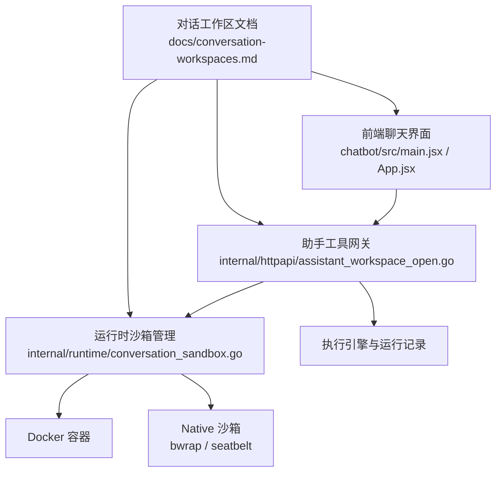
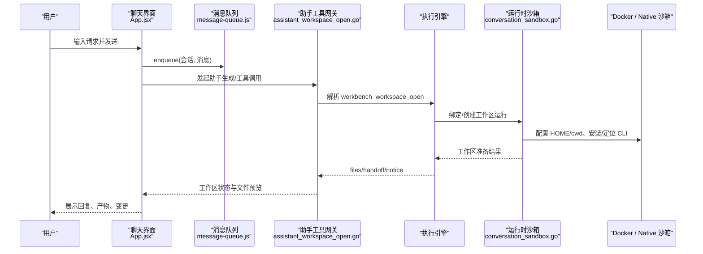
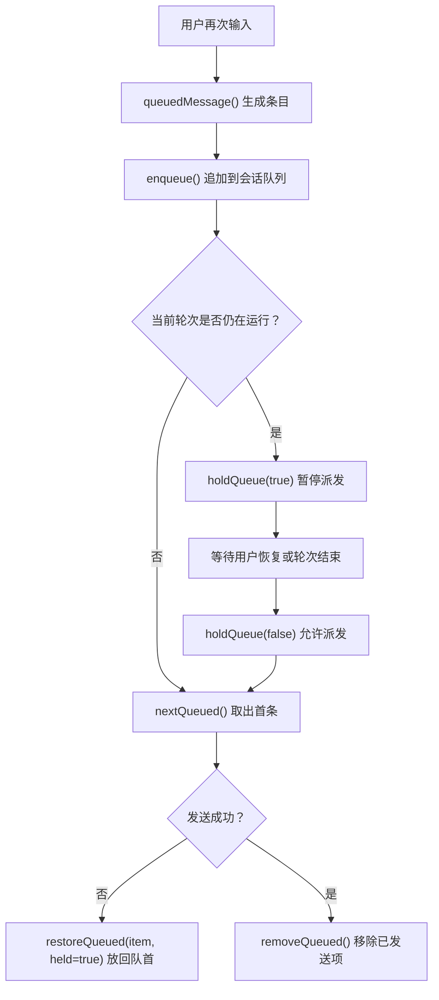
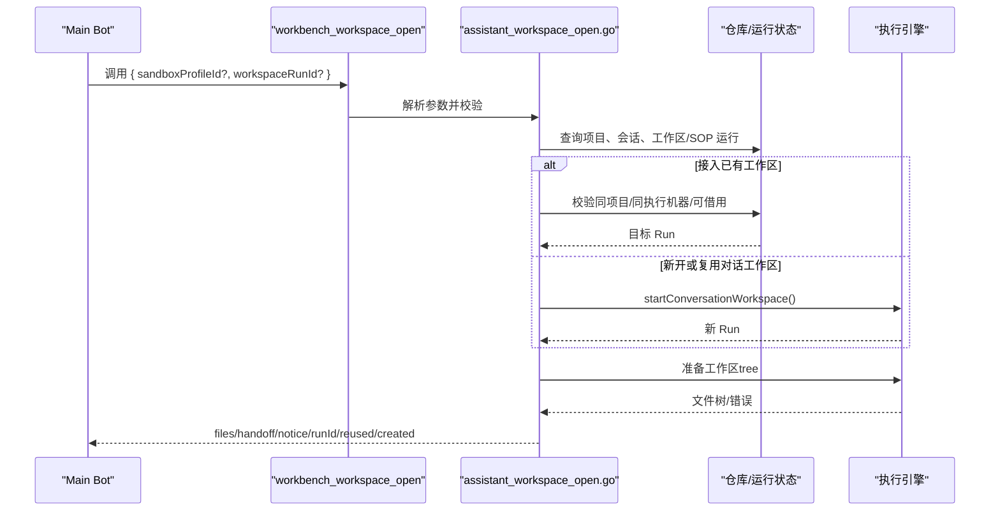
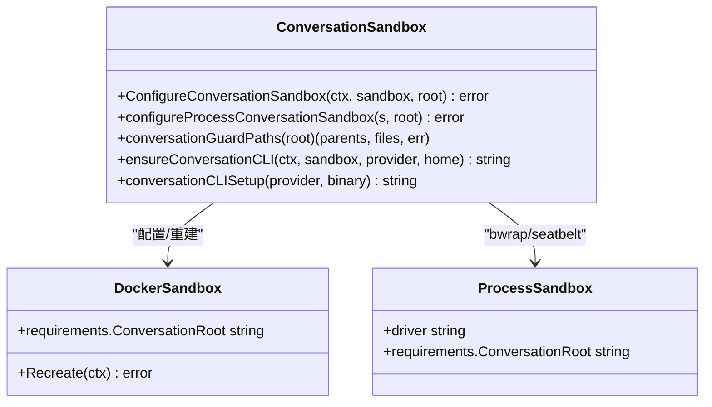
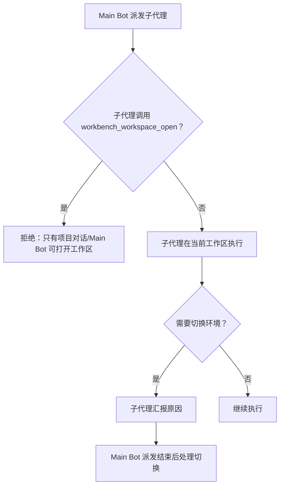
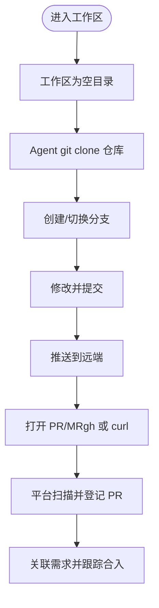
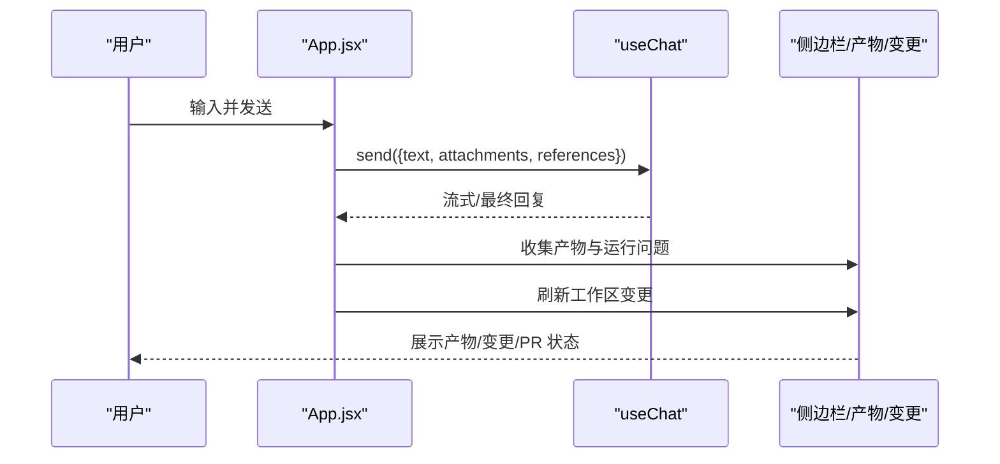
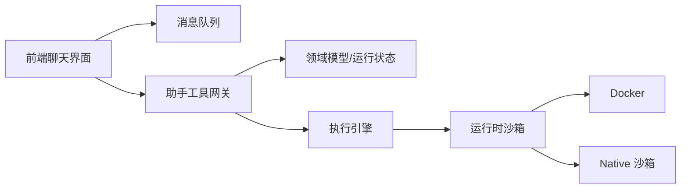

# 聊天工作区

<cite>
**本文引用的文件**   
- [README.md](file://README.md)
- [conversation-workspaces.md](file://docs/conversation-workspaces.md)
- [main.jsx](file://chatbot/src/main.jsx)
- [App.jsx](file://chatbot/src/App.jsx)
- [message-queue.js](file://chatbot/src/message-queue.js)
- [assistant_workspace_open.go](file://internal/httpapi/assistant_workspace_open.go)
- [conversation_sandbox.go](file://internal/runtime/conversation_sandbox.go)
</cite>

## 目录
1. [简介](#简介)
2. [项目结构](#项目结构)
3. [核心组件](#核心组件)
4. [架构总览](#架构总览)
5. [详细组件分析](#详细组件分析)
6. [依赖关系分析](#依赖关系分析)
7. [性能与可靠性](#性能与可靠性)
8. [故障排查指南](#故障排查指南)
9. [结论](#结论)

## 简介
本文件面向“聊天工作区”这一能力，覆盖 Main Bot 的对话机制、消息队列、子代理调用与状态同步；解释 Docker 沙箱与工作区生命周期、仓库检出与文件操作；梳理用户界面交互流程、消息格式与实时通信要点；并提供实际对话示例、错误处理与调试技巧。

LoopForge 的聊天工作区不是“一次性的代码检出”，而是一个按需启动的运行环境：Main Bot 在需要看代码、改代码、跑命令或访问 GitHub 时，通过工具进入工作区模式，使用会话绑定的运行环境（Docker 或 native 沙箱），由 Agent 自行 clone 仓库、创建分支、提交、推送并打开 PR/MR。普通对话同一时间只绑定一个工作区，切换环境会解绑旧工作区并在空闲回收前保存快照；SOP 运行也有自己的独立工作区，普通对话可以接入同项目且在同一执行机器上的 SOP 工作区进行协作。

**章节来源**
- [README.md:38-50](file://README.md#L38-L50)
- [conversation-workspaces.md:1-12](file://docs/conversation-workspaces.md#L1-L12)

## 项目结构
聊天工作区涉及前端 React 应用、后端 HTTP API、运行时沙箱以及文档说明：



**图表来源**
- [main.jsx:1-37](file://chatbot/src/main.jsx#L1-L37)
- [App.jsx:306-800](file://chatbot/src/App.jsx#L306-L800)
- [assistant_workspace_open.go:16-30](file://internal/httpapi/assistant_workspace_open.go#L16-L30)
- [conversation_sandbox.go:16-47](file://internal/runtime/conversation_sandbox.go#L16-L47)
- [conversation-workspaces.md:1-12](file://docs/conversation-workspaces.md#L1-L12)

**章节来源**
- [main.jsx:1-37](file://chatbot/src/main.jsx#L1-L37)
- [App.jsx:306-800](file://chatbot/src/App.jsx#L306-L800)
- [assistant_workspace_open.go:16-30](file://internal/httpapi/assistant_workspace_open.go#L16-L30)
- [conversation_sandbox.go:16-47](file://internal/runtime/conversation_sandbox.go#L16-L47)
- [conversation-workspaces.md:1-12](file://docs/conversation-workspaces.md#L1-L12)

## 核心组件
- 前端入口与主应用：负责渲染聊天界面、草稿、附件、模型选择、环境选择、侧边栏产物与变更面板。
- 消息队列：按会话维护待发消息，支持排队、暂停、恢复、失败重试和持久化。
- 工作区打开工具：后端将对话绑定到工作区运行，返回文件树、是否交接给工作区模式、通知信息。
- 沙箱配置：为对话工作区注入 HOME/cwd 挂载，支持 Docker 与 native 沙箱，准备原生 CLI。
- 文档规范：定义工作区语义、Git 凭据、生命周期、权限、需求关联与统计口径。

**章节来源**
- [main.jsx:1-37](file://chatbot/src/main.jsx#L1-L37)
- [App.jsx:306-800](file://chatbot/src/App.jsx#L306-L800)
- [message-queue.js:1-91](file://chatbot/src/message-queue.js#L1-L91)
- [assistant_workspace_open.go:16-30](file://internal/httpapi/assistant_workspace_open.go#L16-L30)
- [conversation_sandbox.go:16-47](file://internal/runtime/conversation_sandbox.go#L16-L47)
- [conversation-workspaces.md:1-12](file://docs/conversation-workspaces.md#L1-L12)

## 架构总览
聊天工作区的端到端流程如下：



**图表来源**
- [App.jsx:306-800](file://chatbot/src/App.jsx#L306-L800)
- [message-queue.js:1-91](file://chatbot/src/message-queue.js#L1-L91)
- [assistant_workspace_open.go:16-30](file://internal/httpapi/assistant_workspace_open.go#L16-L30)
- [conversation_sandbox.go:16-47](file://internal/runtime/conversation_sandbox.go#L16-L47)

## 详细组件分析

### 前端聊天界面与交互
- 入口 `main.jsx` 提供 React 根节点与全局错误边界，当渲染异常时显示“工作台暂时无法打开”并引导重新加载。
- `App.jsx` 聚合聊天状态、会话列表、草稿、附件、引用、模型与权限选择、环境选择、侧边栏产物与变更面板、浏览器代理等。它负责：
  - 新建对话、选择项目、选择模型与权限模式。
  - 提交消息，清理草稿与附件，保持滚动跟随。
  - 根据会话的 `workspaceRunId` 监听工作区变更，刷新侧边栏“改动”。
  - 将本地生成的产物与运行问题合并到侧边栏。
  - 通过父窗口消息协议与宿主页面导航。

```mermaid
flowchart TD
Start(["用户打开聊天"]) --> Init["初始化会话与草稿"]
Init --> Compose["编辑文本/附件/引用"]
Compose --> Submit{"点击发送？"}
Submit --> |是| Send["调用 useChat.send()"]
Send --> QueueCheck{"是否有正在运行的轮次？"}
QueueCheck --> |是| Enqueue["加入消息队列"]
QueueCheck --> |否| Dispatch["直接派发助手生成"]
Dispatch --> Result["接收流式/最终回复"]
Result --> Workspace{"是否需要工作区？"}
Workspace --> |是| OpenWS["workbench_workspace_open"]
Workspace --> |否| ShowReply["展示回复与产物"]
OpenWS --> ShowReply
ShowReply --> End(["结束本轮或继续排队"))
```

**图表来源**
- [main.jsx:15-31](file://chatbot/src/main.jsx#L15-L31)
- [App.jsx:306-800](file://chatbot/src/App.jsx#L306-L800)

**章节来源**
- [main.jsx:15-31](file://chatbot/src/main.jsx#L15-L31)
- [App.jsx:306-800](file://chatbot/src/App.jsx#L306-L800)

### 消息队列处理
前端消息队列按会话维护有序消息，支持：
- 入队：`enqueue(queues, sessionId, item)`
- 出队：`nextQueued(queues, sessionId)`
- 删除：`removeQueued(queues, sessionId, itemId)`
- 恢复失败消息：`restoreQueued(queues, sessionId, item, held)`
- 暂停/恢复队列：`holdQueue(queues, sessionId, held)`
- 持久化：`readQueues`/`writeQueues` 基于 `localStorage`，页面重载后默认暂停，避免后台自动重发。



**图表来源**
- [message-queue.js:18-91](file://chatbot/src/message-queue.js#L18-L91)

**章节来源**
- [message-queue.js:1-91](file://chatbot/src/message-queue.js#L1-L91)

### Main Bot 的工作区打开与状态同步
后端工具 `workbench_workspace_open` 描述了一个工作区打开契约：
- 参数仅接受 `sandboxProfileId` 与可选的 `workspaceRunId`。
- 不传参数或传入相同环境时继续使用当前工作区；传入不同环境则切换。
- 可接入同项目且在同一执行机器上的 SOP 运行或本对话之前开过的工作区。
- 返回 `files`、`handoff`、`notice`、`runId`、`reused`、`created`、`previousRunId` 等字段。
- 若目标不可用，返回可操作错误，不会静默替换。



**图表来源**
- [assistant_workspace_open.go:16-30](file://internal/httpapi/assistant_workspace_open.go#L16-L30)
- [assistant_workspace_open.go:122-210](file://internal/httpapi/assistant_workspace_open.go#L122-L210)
- [assistant_workspace_open.go:315-437](file://internal/httpapi/assistant_workspace_open.go#L315-L437)

**章节来源**
- [assistant_workspace_open.go:16-30](file://internal/httpapi/assistant_workspace_open.go#L16-L30)
- [assistant_workspace_open.go:122-210](file://internal/httpapi/assistant_workspace_open.go#L122-L210)
- [assistant_workspace_open.go:315-437](file://internal/httpapi/assistant_workspace_open.go#L315-L437)

### Docker 与 Native 沙箱管理
运行时负责为对话工作区注入稳定的 HOME 与工作区目录挂载，并支持 Docker 与 native 沙箱：
- Docker：通过 `Recreate` 重建容器以应用新的 conversation root。
- Native：Linux 使用 `bwrap`，macOS 使用 `seatbelt`；HOME 固定到会话根目录，工作区模式下 cwd 指向运行工作区。
- 安全加固：将审批钩子配置文件锚定并只读挂载，防止替换或改名。
- CLI 准备：优先复用镜像内 CLI，否则通过受管 CLI 清单或系统 PATH 查找；必要时在工作区镜像中安装 Node/npm/Python 并安装官方 CLI。



**图表来源**
- [conversation_sandbox.go:16-47](file://internal/runtime/conversation_sandbox.go#L16-L47)
- [conversation_sandbox.go:49-64](file://internal/runtime/conversation_sandbox.go#L49-L64)
- [conversation_sandbox.go:76-117](file://internal/runtime/conversation_sandbox.go#L76-L117)
- [conversation_sandbox.go:159-212](file://internal/runtime/conversation_sandbox.go#L159-L212)
- [conversation_sandbox.go:214-253](file://internal/runtime/conversation_sandbox.go#L214-L253)

**章节来源**
- [conversation_sandbox.go:16-47](file://internal/runtime/conversation_sandbox.go#L16-L47)
- [conversation_sandbox.go:49-64](file://internal/runtime/conversation_sandbox.go#L49-L64)
- [conversation_sandbox.go:76-117](file://internal/runtime/conversation_sandbox.go#L76-L117)
- [conversation_sandbox.go:159-212](file://internal/runtime/conversation_sandbox.go#L159-L212)
- [conversation_sandbox.go:214-253](file://internal/runtime/conversation_sandbox.go#L214-L253)

### 子代理调用与状态同步
- 子代理（角色子 Agent）不能直接调用 `workbench_workspace_open`，平台会在派发阶段拒绝。
- 子代理与 Main Bot 共用同一个已绑定的工作区；若子代理需要另一个环境，应在汇报中说明，由 Main Bot 在派发结束后处理。
- 工作区切换与轮次结束时保存快照，避免丢失未推送改动；切换失败时保留原绑定或恢复原绑定，保证状态一致性。
- 普通对话与 SOP 工作区状态通过运行记录与会话字段同步，包括 `workspaceRunId`、`ownWorkspaceRunIds`、执行机器与沙箱环境。



**图表来源**
- [conversation-workspaces.md:24-29](file://docs/conversation-workspaces.md#L24-L29)
- [assistant_workspace_open.go:122-135](file://internal/httpapi/assistant_workspace_open.go#L122-L135)

**章节来源**
- [conversation-workspaces.md:24-29](file://docs/conversation-workspaces.md#L24-L29)
- [assistant_workspace_open.go:122-135](file://internal/httpapi/assistant_workspace_open.go#L122-L135)

### 仓库检出与文件操作
- 工作区默认空目录，不预先检出任何仓库、不建分支。
- Agent 自行使用 git clone、checkout、branch、commit、push，必要时 merge 并打开 PR/MR。
- Git 凭据按本轮发言人注入：HTTPS Token、SSH 私钥、GH_TOKEN、提交身份等，敏感信息脱敏。
- 平台在本轮结束时扫描工作区内的 git 检出，对 github.com 远程仓库尝试登记最近创建的 PR，满足条件后关联需求并跟踪合入。



**图表来源**
- [conversation-workspaces.md:7-12](file://docs/conversation-workspaces.md#L7-L12)
- [conversation-workspaces.md:13-23](file://docs/conversation-workspaces.md#L13-L23)
- [conversation-workspaces.md:58-64](file://docs/conversation-workspaces.md#L58-L64)

**章节来源**
- [conversation-workspaces.md:7-12](file://docs/conversation-workspaces.md#L7-L12)
- [conversation-workspaces.md:13-23](file://docs/conversation-workspaces.md#L13-L23)
- [conversation-workspaces.md:58-64](file://docs/conversation-workspaces.md#L58-L64)

### 用户界面交互流程
- 用户在聊天框输入文本、附件与引用，可选择模型、权限模式与环境。
- 发送后，若当前轮次仍在运行，消息进入队列；轮次结束后再依次派发。
- 若 Main Bot 决定进入工作区，前端展示工作区相关通知与文件预览；侧边栏展示产物与变更。
- 工作区变更通过 `useWorkspaceChanges` 监听，轮次结束后刷新差异。



**图表来源**
- [App.jsx:306-800](file://chatbot/src/App.jsx#L306-L800)

**章节来源**
- [App.jsx:306-800](file://chatbot/src/App.jsx#L306-L800)

### 消息格式定义与实时通信
- 前端消息对象包含 `id`、`text`、`attachments`、`references`、`approvalMode`、`queuedAt`。
- 队列持久化键为 `agentflow.native-chat.queue.v1`，页面重载后默认暂停派发。
- 实时通信主要通过助手生成流式响应与工具调用结果反馈；工作区准备完成后返回文件树与交接标志。

**章节来源**
- [message-queue.js:18-91](file://chatbot/src/message-queue.js#L18-L91)
- [assistant_workspace_open.go:175-207](file://internal/httpapi/assistant_workspace_open.go#L175-L207)

### 实际对话示例
以下示例用于理解工作区行为，不包含具体代码内容：
- 示例一：用户要求修复某个 bug，Main Bot 先检查上下文，然后调用 `workbench_workspace_open` 进入 Docker 工作区，clone 仓库、创建分支、修改代码、提交并推送，最后打开 PR。平台在本轮结束时登记 PR 并关联需求。
- 示例二：用户希望复用某次暂停的 SOP 工作区，传入 `workspaceRunId` 直接接入；若不在同一执行机器，平台返回明确错误并提示切换到对应执行机器下的对话。
- 示例三：用户切换环境，从 `generic-docker` 切换到自定义沙箱；旧工作区解绑并在空闲回收前保存快照，新工作区从零开始，Agent 自行 clone 所需仓库。

**章节来源**
- [conversation-workspaces.md:1-12](file://docs/conversation-workspaces.md#L1-L12)
- [conversation-workspaces.md:24-39](file://docs/conversation-workspaces.md#L24-L39)
- [assistant_workspace_open.go:122-210](file://internal/httpapi/assistant_workspace_open.go#L122-L210)

## 依赖关系分析
聊天工作区的依赖关系如下：



**图表来源**
- [App.jsx:306-800](file://chatbot/src/App.jsx#L306-L800)
- [message-queue.js:1-91](file://chatbot/src/message-queue.js#L1-L91)
- [assistant_workspace_open.go:16-30](file://internal/httpapi/assistant_workspace_open.go#L16-L30)
- [conversation_sandbox.go:16-47](file://internal/runtime/conversation_sandbox.go#L16-L47)

**章节来源**
- [App.jsx:306-800](file://chatbot/src/App.jsx#L306-L800)
- [message-queue.js:1-91](file://chatbot/src/message-queue.js#L1-L91)
- [assistant_workspace_open.go:16-30](file://internal/httpapi/assistant_workspace_open.go#L16-L30)
- [conversation_sandbox.go:16-47](file://internal/runtime/conversation_sandbox.go#L16-L47)

## 性能与可靠性
- 工作区快照仅在轮次结束或切换工作区前保存，避免逐条命令保存完整快照带来的开销。
- 切换失败时保留原绑定或恢复原绑定，确保状态一致。
- 空闲回收在保存兜底快照后进行，避免误回收未完成的工作区。
- 消息队列页面重载后默认暂停，避免后台自动重发造成重复派发。
- 沙箱准备失败时返回可操作错误，不会静默替换环境。

[本节为通用指导，不直接分析具体文件]

## 故障排查指南
- 工作区准备失败：检查沙箱环境是否可用、Dockerfile 是否存在、执行机器是否在线；查看返回的 `previousCheckpointError` 与 `notice`。
- 无法接入 SOP 工作区：确认目标运行属于当前项目且在同一执行机器；子 SOP 会自动定位到父工作区。
- Git 凭据问题：检查 HTTPS Token、SSH 私钥、GH_TOKEN 是否正确注入；注意敏感信息脱敏与主机公钥固定。
- 消息队列卡住：检查是否处于 `held` 状态；页面重载后会默认暂停，需用户恢复。
- 前端错误边界：若出现“工作台暂时无法打开”，可尝试重新加载页面。

**章节来源**
- [assistant_workspace_open.go:175-207](file://internal/httpapi/assistant_workspace_open.go#L175-L207)
- [assistant_workspace_open.go:315-437](file://internal/httpapi/assistant_workspace_open.go#L315-L437)
- [conversation-workspaces.md:13-23](file://docs/conversation-workspaces.md#L13-L23)
- [message-queue.js:66-91](file://chatbot/src/message-queue.js#L66-L91)
- [main.jsx:15-31](file://chatbot/src/main.jsx#L15-L31)

## 结论
聊天工作区将 Main Bot 的对话能力与可复用的运行环境结合，既保留了对话的灵活性与实时性，又提供了安全的隔离环境与可追踪的交付链路。通过消息队列、工作区打开工具、沙箱管理与文档规范，团队可以在聊天中快速迭代，也可以沉淀为 SOP 实现稳定交付。对于常见问题，应优先检查工作区绑定、执行机器一致性、沙箱环境与 Git 凭据，并结合前端错误边界与队列状态进行定位。

[本节为总结性内容，不直接分析具体文件]