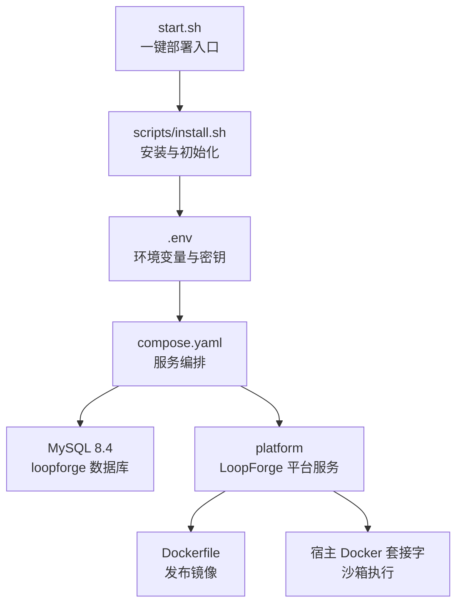
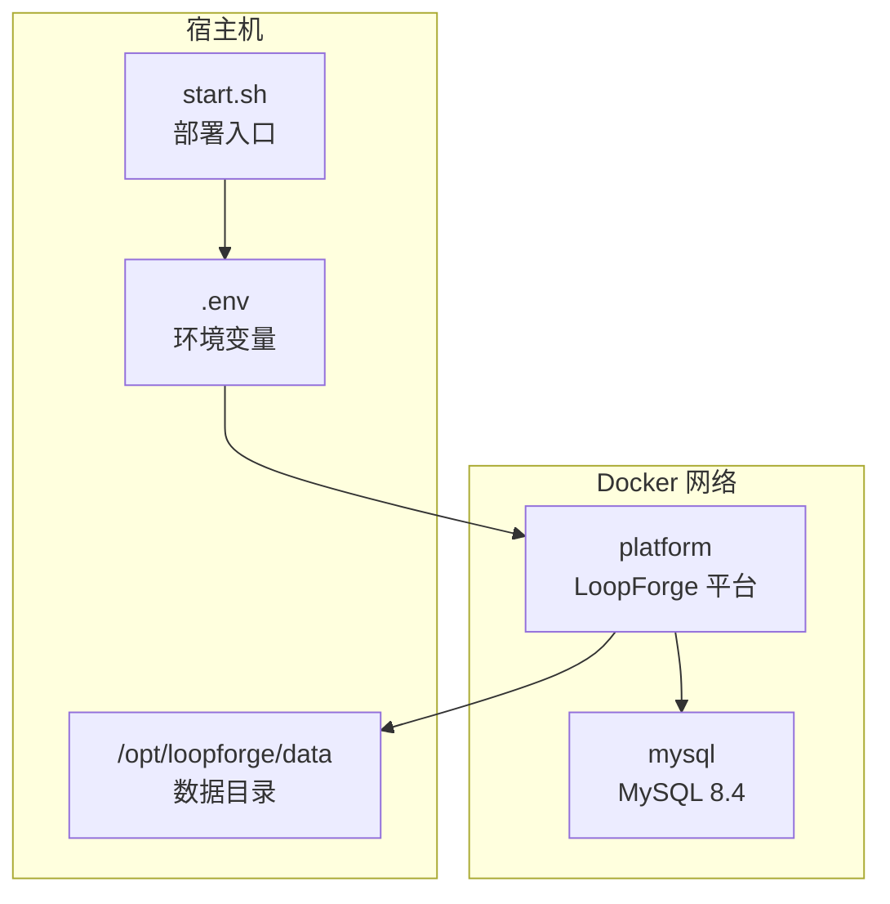
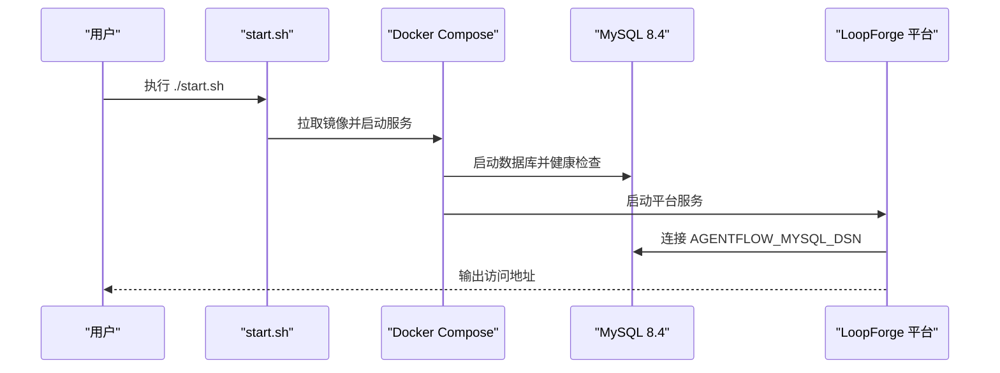

# 基础部署

<cite>
**本文引用的文件**   
- [README.md](file://README.md)
- [compose.yaml](file://compose.yaml)
- [Dockerfile](file://Dockerfile)
- [start.sh](file://start.sh)
- [scripts/configure.sh](file://scripts/configure.sh)
- [docs/deployment.md](file://docs/deployment.md)
- [cmd/agentflow/main.go](file://cmd/agentflow/main.go)
</cite>

## 目录
1. [简介](#简介)
2. [环境要求](#环境要求)
3. [项目结构中的部署相关部分](#项目结构中的部署相关部分)
4. [快速部署步骤](#快速部署步骤)
5. [环境变量配置说明](#环境变量配置说明)
6. [单机部署完整示例](#单机部署完整示例)
7. [启动脚本使用方法](#启动脚本使用方法)
8. [常见部署问题与排查](#常见部署问题与排查)
9. [架构概览](#架构概览)
10. [结论](#结论)

## 简介
本文件面向首次部署 LoopForge 的运维和开发者，聚焦“基础部署”：在本地或单台服务器上，使用 Docker Compose 拉起 MySQL 8.4 和 LoopForge 平台服务，完成数据持久化、端口映射、会话密钥、数据库连接以及 GitHub OAuth 等必要配置。文档同时给出 `start.sh` 的使用方式、常见问题定位方法，以及从容器镜像到 Compose 服务的整体运行关系。

## 环境要求
LoopForge 的基础部署依赖以下组件：

| 组件 | 最低要求或默认行为 | 说明 |
|---|---|---|
| Docker | 已安装并可被当前用户调用 | 用于运行 MySQL 和 LoopForge 容器；Compose 插件用于编排服务。 |
| Docker Compose | 支持 `profiles`、`depends_on`、`healthcheck`、卷挂载 | 由 `compose.yaml` 定义 MySQL 和平台服务。 |
| Python 3 | 用于安装脚本生成 `.env` 和初始化数据 | 安装脚本会检查并尝试安装缺失组件。 |
| curl | 用于下载镜像、校验资源 | 安装流程需要网络访问。 |
| MySQL | 官方镜像 `mysql:8.4` | 默认字符集为 `utf8mb4`，排序规则为 `utf8mb4_unicode_ci`。 |
| Go 运行时 | 仅源码构建时需要 | 默认通过发布镜像运行，不需要宿主机安装 Go。 |
| Node.js / npm | 仅源码构建或本地开发时需要 | 默认发布镜像不包含交互式开发工具链。 |

推荐优先使用发布镜像运行，而不是在宿主机编译 Go 代码。源码构建可通过 `./start.sh dev` 触发，但基础部署文档以发布镜像为主。

**章节来源**
- [README.md:72-92](file://README.md#L72-L92)
- [compose.yaml:3-10](file://compose.yaml#L3-L10)
- [Dockerfile:13-33](file://Dockerfile#L13-L33)
- [docs/deployment.md:24-41](file://docs/deployment.md#L24-L41)

## 项目结构中的部署相关部分
LoopForge 的部署能力集中在以下几个位置：

- `compose.yaml`：定义 MySQL 8.4 和 LoopForge 平台服务、端口映射、健康检查、数据卷、环境变量和依赖关系。
- `Dockerfile`：定义发布镜像的构建过程，包含前端静态资源、Go 二进制、CLI 工具、Python 运行时和 Docker CLI。
- `start.sh`：对外暴露的一键安装、启动、日志、停止、重启、拉取镜像、切换发布镜像或源码构建的命令入口。
- `scripts/configure.sh`：生成 `.env`，写入数据库密码、会话密钥、数据目录、绑定地址、HTTP 端口等初始配置。
- `docs/deployment.md`：详细说明容器安装、升级、沙箱、GitHub 授权、账号模型、可观测性迁移等部署主题。
- `cmd/agentflow/main.go`：服务端启动逻辑，包括会话密钥校验、MySQL DSN、监听地址等关键参数处理。



**图表来源**
- [start.sh:1-72](file://start.sh#L1-L72)
- [compose.yaml:1-71](file://compose.yaml#L1-L71)
- [Dockerfile:1-68](file://Dockerfile#L1-L68)

**章节来源**
- [compose.yaml:1-71](file://compose.yaml#L1-L71)
- [Dockerfile:1-68](file://Dockerfile#L1-L68)
- [start.sh:1-72](file://start.sh#L1-L72)
- [scripts/configure.sh:1-23](file://scripts/configure.sh#L1-L23)
- [docs/deployment.md:24-82](file://docs/deployment.md#L24-L82)

## 快速部署步骤
推荐使用仓库根目录下的 `start.sh` 进行快速部署。该脚本会检查 Docker、Compose、Python 3 和 curl，必要时提示安装缺失组件，然后生成 `.env`、拉取镜像、启动服务、应用种子数据和可观测性列。

### 标准安装流程
1. 克隆仓库并进入目录。
2. 运行 `./start.sh`。
3. 等待控制台输出平台访问地址。
4. 在浏览器中打开地址，创建第一个账号；第一个账号会成为平台管理员。
5. 根据需要配置模型 API Key、GitHub 授权、工作区、SOP 等。

### 镜像拉取失败时的镜像源
如果 `ghcr.io` 下载缓慢或被阻断，可以设置 `MIRROR` 变量，让安装脚本从指定镜像源拉取并发布镜像。例如：

```bash
MIRROR=ghcr.nju.edu.cn ./start.sh
```

该方式会把镜像源拉取的镜像重新打上 `compose.yaml` 中固定的官方名称标签，从而保持 Compose 配置不变。

**章节来源**
- [README.md:72-92](file://README.md#L72-L92)
- [README.md:84-88](file://README.md#L84-L88)
- [docs/deployment.md:24-57](file://docs/deployment.md#L24-L57)

## 环境变量配置说明
LoopForge 的环境变量分为三类：

1. **安装与 Compose 层变量**：如 `LOOPFORGE_DATA_DIR`、`LOOPFORGE_BIND`、`LOOPFORGE_MYSQL_PORT`、`LOOPFORGE_IMAGE`、`AGENTFLOW_HTTP_PORT`。
2. **平台运行时变量**：如 `AGENTFLOW_MYSQL_DSN`、`AGENTFLOW_SESSION_SECRET`、`AGENTFLOW_ALLOW_SIGNUP`、`AGENTFLOW_SECURE_COOKIES`、`AGENTFLOW_GITHUB_CLIENT_ID`。
3. **沙箱与工作区变量**：如 `AGENTFLOW_CONVERSATION_DIR`、`AGENTFLOW_ASSISTANT_SESSION_DIR`、`AGENTFLOW_LOCAL_SANDBOX`、`AGENTFLOW_ISOLATED_IMAGE`。

### 必须配置的核心变量

| 变量 | 默认值或行为 | 用途 | 注意事项 |
|---|---|---|---|
| `LOOPFORGE_DATA_DIR` | `.data` | 平台数据目录，包含对话、工作区、CLI 缓存等 | 建议放在版本控制之外，避免丢失数据。 |
| `LOOPFORGE_BIND` | `0.0.0.0` | 平台 HTTP 监听地址 | 生产环境建议使用反向代理和 HTTPS。 |
| `LOOPFORGE_MYSQL_PORT` | `33315` | 宿主机上 MySQL 的映射端口 | 若端口冲突需提前修改。 |
| `AGENTFLOW_HTTP_PORT` | `8090` | 宿主机上平台服务映射端口 | 默认映射到容器内 `8080`。 |
| `AGENTFLOW_MYSQL_DSN` | 由安装脚本生成 | MySQL 连接字符串 | 外部 MySQL 可直接覆盖该值。 |
| `AGENTFLOW_SESSION_SECRET` | 随机生成 | 会话签名密钥 | 必须稳定，跨实例和重启保持一致。 |
| `AGENTFLOW_ALLOW_SIGNUP` | `true` | 是否允许自助注册 | 公网环境建议设为 `false`。 |
| `AGENTFLOW_SECURE_COOKIES` | `false` | 是否启用安全 Cookie | 使用 HTTPS 反向代理时建议设为 `true`。 |
| `AGENTFLOW_GITHUB_CLIENT_ID` | 空 | GitHub OAuth 设备码流程 Client ID | 可选；不填时使用内置应用。 |

### 数据库连接
默认情况下，`compose.yaml` 会启动一个 MySQL 8.4 容器，并使用 `loopforge` 数据库和用户。平台服务通过 `AGENTFLOW_MYSQL_DSN` 连接数据库。如果你已有外部 MySQL，可以在 `.env` 中直接设置 `AGENTFLOW_MYSQL_DSN`，不再依赖 Compose 内的 MySQL 容器。

### 会话密钥
`AGENTFLOW_SESSION_SECRET` 是平台会话安全的必要配置。服务端启动时会检查该变量是否为空；如果为空且不是本地 CLI 管理动作，则会拒绝启动。安装脚本会为首次安装生成随机密钥。

### GitHub OAuth
GitHub 集成支持两种模式：

- **内置应用**：新安装默认使用 LoopForge 内置的 GitHub OAuth App，用户只需在个人设置中选择“连接 GitHub”，复制设备码并在 GitHub 上授权即可。
- **自定义应用**：如果需要企业自有 OAuth App，可在 `.env` 中设置 `AGENTFLOW_GITHUB_CLIENT_ID`。该值会覆盖内置应用和数据库中的配置。

注意：GitHub OAuth 设备码流程不需要 Client Secret，只需要公开的 Client ID。

**章节来源**
- [compose.yaml:5-45](file://compose.yaml#L5-L45)
- [scripts/configure.sh:16-20](file://scripts/configure.sh#L16-L20)
- [cmd/agentflow/main.go:89-112](file://cmd/agentflow/main.go#L89-L112)
- [docs/deployment.md:67-73](file://docs/deployment.md#L67-L73)
- [docs/deployment.md:172-182](file://docs/deployment.md#L172-L182)

## 单机部署完整示例
以下是一个典型的单机部署示例，适用于本地开发、测试或小团队内部使用。

### 前置准备
- 安装 Docker 和 Docker Compose。
- 确保 `8090` 和 `33315` 未被占用（可通过环境变量调整）。
- 准备一个稳定的数据目录，例如 `/opt/loopforge/data`。

### 最小化 .env 配置
你可以手动创建 `.env`，或使用安装脚本自动生成。最小化配置至少应包含：

| 配置项 | 示例值 | 说明 |
|---|---|---|
| `LOOPFORGE_DATA_DIR` | `/opt/loopforge/data` | 持久化数据目录。 |
| `LOOPFORGE_DB_PASSWORD` | 随机字符串 | MySQL 普通用户密码。 |
| `LOOPFORGE_DB_ROOT_PASSWORD` | 随机字符串 | MySQL root 密码。 |
| `LOOPFORGE_MYSQL_PORT` | `33315` | 宿主机 MySQL 端口。 |
| `AGENTFLOW_HTTP_PORT` | `8090` | 宿主机平台端口。 |
| `AGENTFLOW_SESSION_SECRET` | 32 字节十六进制字符串 | 会话密钥。 |
| `AGENTFLOW_ALLOW_SIGNUP` | `false` | 公网环境建议关闭自助注册。 |
| `AGENTFLOW_SECURE_COOKIES` | `true` | 使用 HTTPS 反向代理时启用。 |
| `AGENTFLOW_GITHUB_CLIENT_ID` | 留空或填写 Client ID | 使用内置应用或自定义 GitHub OAuth App。 |

### 端口映射
默认情况下：

- 平台服务映射到 `0.0.0.0:8090`。
- MySQL 映射到 `127.0.0.1:33315`。

这意味着平台服务对外暴露，而 MySQL 只允许本机访问，适合单机部署。

### 数据持久化
`compose.yaml` 使用两个卷：

- `mysql-data`：MySQL 数据目录。
- `platform-data`：平台数据目录。

此外，`LOOPFORGE_DATA_DIR` 会被绑定到宿主机的绝对路径，使对话、工作区和 CLI 状态在容器重启后仍然存在。

### 启动命令
```bash
cd /path/to/LoopForge
./start.sh
```

启动成功后，控制台会打印访问地址。首次访问页面创建管理员账号。

**章节来源**
- [compose.yaml:11-14](file://compose.yaml#L11-L14)
- [compose.yaml:25-57](file://compose.yaml#L25-L57)
- [scripts/configure.sh:16-20](file://scripts/configure.sh#L16-L20)
- [docs/deployment.md:37-41](file://docs/deployment.md#L37-L41)
- [docs/deployment.md:67-82](file://docs/deployment.md#L67-L82)

## 启动脚本使用方法
`start.sh` 是 LoopForge 的基础部署入口，封装了安装、镜像拉取、容器管理和源码构建等常用操作。

### 常用命令

| 命令 | 作用 | 说明 |
|---|---|---|
| `./start.sh` | 后台安装并启动 | 等价于 `./start.sh -d`。 |
| `./start.sh logs` | 查看平台日志 | 默认跟随 `platform` 服务日志。 |
| `./start.sh stop` | 停止容器 | 保留数据卷。 |
| `./start.sh down` | 删除容器 | 保留数据卷，移除孤儿容器。 |
| `./start.sh restart` | 重启平台容器 | 通常用于配置变更后重启。 |
| `./start.sh pull` | 刷新镜像并重建 | 会重新拉取镜像并应用可观测性列。 |
| `./start.sh dev` | 源码构建并启动 | 使用 `compose.dev.yaml` 构建当前检出。 |
| `./start.sh release` | 切回发布镜像 | 清除源码构建标记，恢复使用 `compose.yaml`。 |

### 镜像源镜像
```bash
MIRROR=ghcr.nju.edu.cn ./start.sh
```

该方式会从指定镜像源拉取发布镜像，并打上 `compose.yaml` 中固定的官方名称标签。

### 源码构建
```bash
./start.sh dev
```

源码构建会使用 `compose.dev.yaml`，并复用 npm、Go module 和 Go 编译器缓存。后续普通 `docker compose` 命令仍会使用源码构建，直到执行 `./start.sh release`。

**章节来源**
- [start.sh:1-72](file://start.sh#L1-L72)
- [docs/deployment.md:24-59](file://docs/deployment.md#L24-L59)

## 常见部署问题与排查
### 1. 启动时报缺少 `AGENTFLOW_SESSION_SECRET`
**现象**：服务启动失败，提示会话密钥缺失。  
**原因**：未生成 `.env`，或 `AGENTFLOW_SESSION_SECRET` 为空。  
**解决**：运行安装脚本生成 `.env`，或手动设置一个足够随机的 32 字节十六进制字符串。

**章节来源**
- [cmd/agentflow/main.go:107-109](file://cmd/agentflow/main.go#L107-L109)
- [scripts/configure.sh:16-20](file://scripts/configure.sh#L16-L20)

### 2. MySQL 无法连接
**现象**：平台启动后无法连接数据库，或健康检查失败。  
**可能原因**：
- `AGENTFLOW_MYSQL_DSN` 配置错误。
- MySQL 容器尚未就绪。
- 外部 MySQL 权限不足。
- 字符集或数据库名不一致。

**排查建议**：
- 检查 `.env` 中的 `LOOPFORGE_DB_PASSWORD` 是否与 MySQL 一致。
- 确认 `compose.yaml` 中 MySQL 健康检查已通过。
- 如果是外部 MySQL，确认 `AGENTFLOW_MYSQL_DSN` 指向正确主机、端口、用户名和密码。
- 确认数据库名为 `loopforge`，字符集为 `utf8mb4`。

**章节来源**
- [compose.yaml:5-19](file://compose.yaml#L5-L19)
- [compose.yaml:27-30](file://compose.yaml#L27-L30)
- [docs/deployment.md:22-23](file://docs/deployment.md#L22-L23)

### 3. 端口冲突
**现象**：平台或 MySQL 无法启动。  
**解决**：
- 修改 `AGENTFLOW_HTTP_PORT` 改变平台宿主机端口。
- 修改 `LOOPFORGE_MYSQL_PORT` 改变 MySQL 宿主机端口。
- 修改 `LOOPFORGE_BIND` 限制监听地址，例如 `127.0.0.1`。

**章节来源**
- [compose.yaml:11-12](file://compose.yaml#L11-L12)
- [compose.yaml:25-26](file://compose.yaml#L25-L26)
- [docs/deployment.md:37-41](file://docs/deployment.md#L37-L41)

### 4. GitHub OAuth 无法登录
**现象**：点击“连接 GitHub”后无法完成授权。  
**可能原因**：
- 使用了自定义 GitHub OAuth App，但未设置 `AGENTFLOW_GITHUB_CLIENT_ID`。
- 企业环境启用了组织 SSO 或第三方应用限制。
- 多实例部署下会话亲和性未配置。

**解决**：
- 使用内置应用：无需额外配置，按页面提示授权即可。
- 使用自定义应用：设置 `AGENTFLOW_GITHUB_CLIENT_ID`。
- 多实例部署：对 `/api/auth/github/*` 配置会话亲和性。
- 企业环境：联系 GitHub 管理员放行 LoopForge OAuth App。

**章节来源**
- [docs/deployment.md:172-182](file://docs/deployment.md#L172-L182)

### 5. 数据丢失风险
**现象**：容器重建后对话、工作区或 CLI 状态丢失。  
**原因**：数据目录未持久化，或 `LOOPFORGE_DATA_DIR` 未绑定到宿主机固定路径。  
**解决**：确保 `.env` 中 `LOOPFORGE_DATA_DIR` 指向稳定路径，并且 `compose.yaml` 中已将该路径绑定到容器。

**章节来源**
- [compose.yaml:46-57](file://compose.yaml#L46-L57)
- [docs/deployment.md:74-82](file://docs/deployment.md#L74-L82)

## 架构概览
下图展示基础部署中主要组件的关系：



**图表来源**
- [start.sh:1-72](file://start.sh#L1-L72)
- [compose.yaml:1-71](file://compose.yaml#L1-L71)

### 服务启动时序


**图表来源**
- [start.sh:22-31](file://start.sh#L22-L31)
- [compose.yaml:15-19](file://compose.yaml#L15-L19)
- [compose.yaml:58-65](file://compose.yaml#L58-L65)

## 结论
LoopForge 的基础部署以 `start.sh` 和 `compose.yaml` 为核心：前者提供开箱即用的安装体验，后者定义 MySQL 8.4 与平台服务的运行关系。对于大多数单机场景，你只需要准备好 Docker、网络和端口，运行一次 `./start.sh`，然后在浏览器中创建管理员账号即可完成初始部署。

生产部署时，请重点关注：
- 使用稳定的 `AGENTFLOW_SESSION_SECRET`。
- 将 `LOOPFORGE_DATA_DIR` 持久化到宿主机。
- 根据网络情况配置 HTTPS 反向代理和安全 Cookie。
- 在公网环境中关闭自助注册。
- 按需配置 GitHub OAuth 和设备码流程。
- 谨慎暴露 Docker 套接字，仅对可信团队开放。