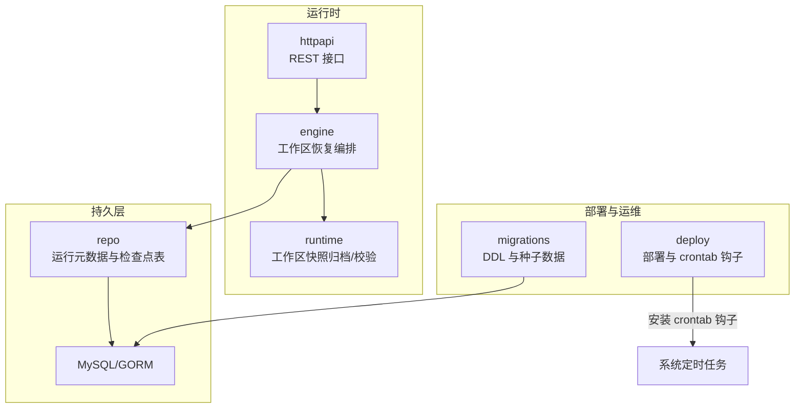
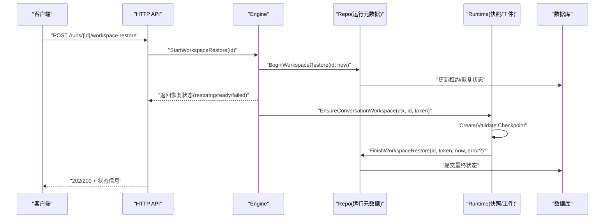
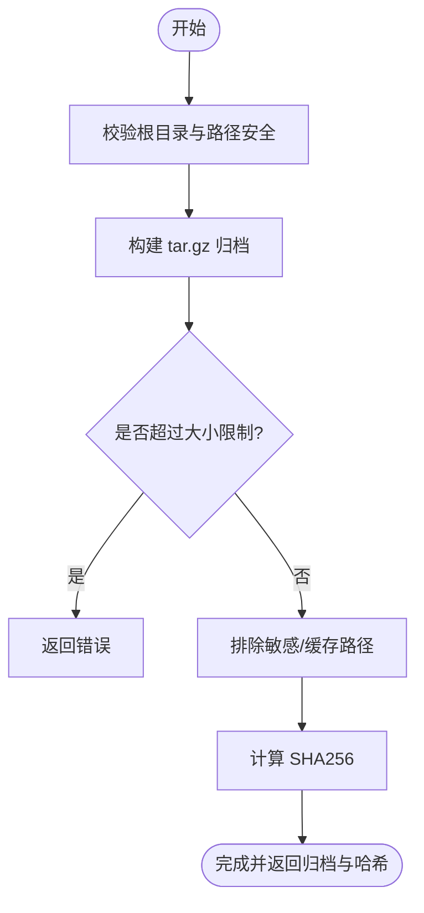
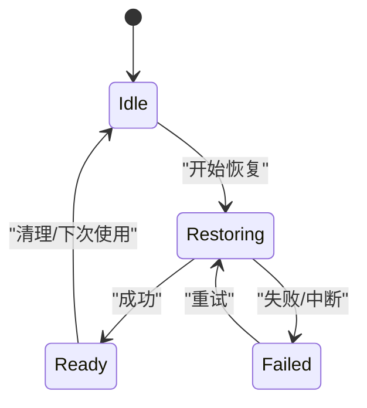
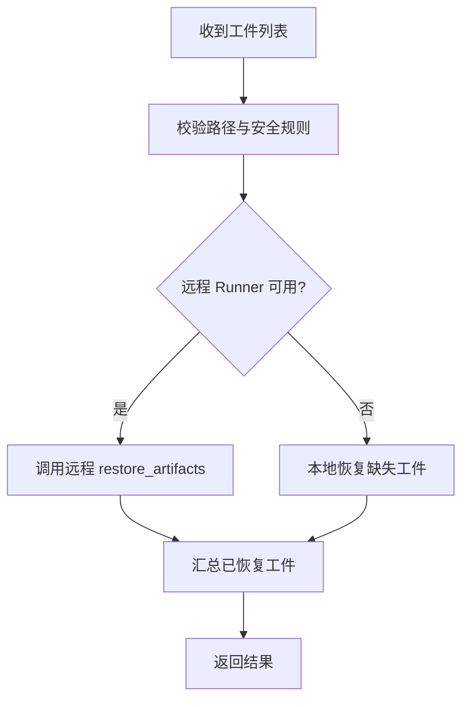
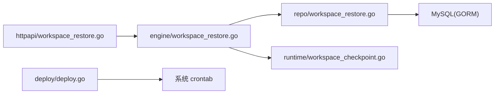

# 备份与恢复

<cite>
**本文引用的文件**   
- [internal/repo/repo.go](file://internal/repo/repo.go)
- [migrations/013_workspace_checkpoints.sql](file://migrations/013_workspace_checkpoints.sql)
- [migrations/018_workspace_restore_status.sql](file://migrations/018_workspace_restore_status.sql)
- [internal/engine/workspace_restore.go](file://internal/engine/workspace_restore.go)
- [internal/httpapi/workspace_restore.go](file://internal/httpapi/workspace_restore.go)
- [internal/repo/workspace_restore.go](file://internal/repo/workspace_restore.go)
- [internal/runtime/workspace_checkpoint.go](file://internal/runtime/workspace_checkpoint.go)
- [internal/engine/conversation_workspace_save_test.go](file://internal/engine/conversation_workspace_save_test.go)
- [internal/engine/workspace_artifacts.go](file://internal/engine/workspace_artifacts.go)
- [internal/runtime/workspace_artifacts.go](file://internal/runtime/workspace_artifacts.go)
- [internal/runtime/workspace_artifacts_test.go](file://internal/runtime/workspace_artifacts_test.go)
- [deploy/deploy.go](file://deploy/deploy.go)
- [deploy/bind_cli_crontab_test.go](file://deploy/bind_cli_crontab_test.go)
</cite>

## 目录
1. [简介](#简介)
2. [项目结构](#项目结构)
3. [核心组件](#核心组件)
4. [架构总览](#架构总览)
5. [详细组件分析](#详细组件分析)
6. [依赖关系分析](#依赖关系分析)
7. [性能考虑](#性能考虑)
8. [故障排查指南](#故障排查指南)
9. [结论](#结论)
10. [附录](#附录)

## 简介
本文件面向运维与平台管理员，系统化说明 LoopForge 的备份与恢复策略。内容覆盖：
- 数据库备份策略（全量、增量、自动任务）
- 数据恢复流程与灾难恢复计划
- 数据一致性保证机制
- 工作区快照、会话与工作区工件文件的备份与恢复
- 迁移脚本管理与版本升级注意事项
- 备份验证方法与恢复演练流程
- 云存储集成与异地备份配置建议

## 项目结构
本项目在代码层面提供了“工作区快照”持久化能力，并通过迁移脚本管理数据库结构变更；同时通过部署脚本暴露定时任务钩子，便于外部备份系统集成。

图表来源
- [internal/runtime/workspace_checkpoint.go:1-123](file://internal/runtime/workspace_checkpoint.go#L1-L123)
- [internal/engine/workspace_restore.go:1-106](file://internal/engine/workspace_restore.go#L1-L106)
- [internal/httpapi/workspace_restore.go:1-149](file://internal/httpapi/workspace_restore.go#L1-L149)
- [internal/repo/repo.go:240-284](file://internal/repo/repo.go#L240-L284)
- [migrations/013_workspace_checkpoints.sql:1-14](file://migrations/013_workspace_checkpoints.sql#L1-L14)
- [migrations/018_workspace_restore_status.sql:1-7](file://migrations/018_workspace_restore_status.sql#L1-L7)
- [deploy/deploy.go](file://deploy/deploy.go)

章节来源
- [internal/repo/repo.go:240-284](file://internal/repo/repo.go#L240-L284)
- [migrations/013_workspace_checkpoints.sql:1-14](file://migrations/013_workspace_checkpoints.sql#L1-L14)
- [migrations/018_workspace_restore_status.sql:1-7](file://migrations/018_workspace_restore_status.sql#L1-L7)

## 核心组件
- 工作区快照（Workspace Checkpoint）
  - 将工作区目录打包为压缩归档，包含 Git 仓库状态与大工件，排除敏感与缓存目录。
  - 提供大小限制、路径安全校验、SHA256 校验等一致性保障。
- 工作区恢复（Workspace Restore）
  - 支持异步恢复、租约控制、失败重试与中断保护。
  - 提供 REST API 查询恢复状态与触发恢复。
- 工件文件恢复（Artifacts Restore）
  - 按需补回归档工件，避免重复覆盖用户修改。
- 数据库连接与迁移
  - GORM 连接池配置与增量 DDL 自动迁移。
  - 迁移脚本位于 migrations/，由运维手动执行。
- 部署与定时任务
  - 部署脚本可写入系统 crontab，用于触发外部备份命令。

章节来源
- [internal/runtime/workspace_checkpoint.go:1-123](file://internal/runtime/workspace_checkpoint.go#L1-L123)
- [internal/engine/workspace_restore.go:1-106](file://internal/engine/workspace_restore.go#L1-L106)
- [internal/httpapi/workspace_restore.go:1-149](file://internal/httpapi/workspace_restore.go#L1-L149)
- [internal/engine/workspace_artifacts.go:84-132](file://internal/engine/workspace_artifacts.go#L84-L132)
- [internal/runtime/workspace_artifacts.go:1-37](file://internal/runtime/workspace_artifacts.go#L1-L37)
- [internal/repo/repo.go:240-284](file://internal/repo/repo.go#L240-L284)

## 架构总览
下图展示从 HTTP 请求到工作区恢复的端到端调用链，以及快照归档与工件恢复的关键交互。

图表来源
- [internal/httpapi/workspace_restore.go:15-80](file://internal/httpapi/workspace_restore.go#L15-L80)
- [internal/engine/workspace_restore.go:45-106](file://internal/engine/workspace_restore.go#L45-L106)
- [internal/repo/workspace_restore.go:13-49](file://internal/repo/workspace_restore.go#L13-L49)
- [internal/runtime/workspace_checkpoint.go:92-123](file://internal/runtime/workspace_checkpoint.go#L92-L123)

## 详细组件分析

### 工作区快照（Checkpoint）
- 功能要点
  - 对根目录进行归档，限制最大体积，分块流式处理，避免大对象进入数据库或 JSON。
  - 排除敏感与缓存目录（如 .agentflow、node_modules、.cache、__pycache__ 等）。
  - 对 Git 索引等危险类型进行拒绝，防止挂起或注入。
  - 归档后提供 SHA256 校验值，供恢复时验证完整性。
- 关键常量与边界
  - 归档大小上限、分块大小、展开解压上限均有明确限制。
- 使用场景
  - 会话结束或空闲回收前保存快照，以便后续恢复工作区。

图表来源
- [internal/runtime/workspace_checkpoint.go:20-40](file://internal/runtime/workspace_checkpoint.go#L20-L40)
- [internal/runtime/workspace_checkpoint.go:92-123](file://internal/runtime/workspace_checkpoint.go#L92-L123)

章节来源
- [internal/runtime/workspace_checkpoint.go:1-123](file://internal/runtime/workspace_checkpoint.go#L1-L123)

### 工作区恢复（Restore）
- 功能要点
  - 支持同步与异步两种模式；异步模式下返回 202 并附带重试头。
  - 基于租约（lease）与令牌（token）保证多实例并发安全。
  - 后台任务负责确保工作区可用，完成后更新恢复状态。
  - 若租约过期或进程退出，会报告“已中断”，需重新发起。
- 状态机
  - idle → restoring → ready/failed
  - failed 后可重试；restoring 期间被抢占会忽略旧任务。

图表来源
- [internal/engine/workspace_restore.go:14-43](file://internal/engine/workspace_restore.go#L14-L43)
- [internal/repo/workspace_restore.go:22-49](file://internal/repo/workspace_restore.go#L22-L49)

章节来源
- [internal/engine/workspace_restore.go:1-106](file://internal/engine/workspace_restore.go#L1-L106)
- [internal/httpapi/workspace_restore.go:15-80](file://internal/httpapi/workspace_restore.go#L15-L80)
- [internal/repo/workspace_restore.go:1-50](file://internal/repo/workspace_restore.go#L1-L50)

### 工件文件恢复（Artifacts）
- 功能要点
  - 按需补回归档工件，不覆盖已有文件，保证幂等。
  - 对工件路径、内容长度、编码、SHA256 进行严格校验。
  - 支持远程 Runner 与本地工作区两种路径。
- 典型流程
  - 引擎根据运行上下文决定走远程 restore_artifacts 还是本地恢复缺失工件。

图表来源
- [internal/engine/workspace_artifacts.go:91-125](file://internal/engine/workspace_artifacts.go#L91-L125)
- [internal/runtime/workspace_artifacts.go:13-37](file://internal/runtime/workspace_artifacts.go#L13-L37)

章节来源
- [internal/engine/workspace_artifacts.go:84-132](file://internal/engine/workspace_artifacts.go#L84-L132)
- [internal/runtime/workspace_artifacts.go:1-37](file://internal/runtime/workspace_artifacts.go#L1-L37)
- [internal/runtime/workspace_artifacts_test.go:1-40](file://internal/runtime/workspace_artifacts_test.go#L1-L40)

### 数据库连接与迁移
- 连接池
  - 设置最大连接数、空闲连接数、连接生命周期，并在启动时 Ping 检测连通性。
- 迁移策略
  - 仅通过 GORM migrator 执行增量 DDL（新增列/表/索引），不包含基线数据与种子数据。
  - 业务迁移脚本位于 migrations/，由运维人员手动执行。

章节来源
- [internal/repo/repo.go:240-284](file://internal/repo/repo.go#L240-L284)

## 依赖关系分析
- HTTP API 层依赖 Engine 编排恢复流程。
- Engine 依赖 Repo 访问运行元数据与检查点表，依赖 Runtime 执行快照与工件操作。
- Repo 通过 GORM 访问 MySQL，受迁移脚本约束。
- 部署脚本负责安装系统级定时任务钩子，便于外部备份工具触发。

图表来源
- [internal/httpapi/workspace_restore.go:1-149](file://internal/httpapi/workspace_restore.go#L1-L149)
- [internal/engine/workspace_restore.go:1-106](file://internal/engine/workspace_restore.go#L1-L106)
- [internal/repo/workspace_restore.go:1-50](file://internal/repo/workspace_restore.go#L1-L50)
- [internal/runtime/workspace_checkpoint.go:1-123](file://internal/runtime/workspace_checkpoint.go#L1-L123)
- [deploy/deploy.go](file://deploy/deploy.go)

章节来源
- [internal/httpapi/workspace_restore.go:1-149](file://internal/httpapi/workspace_restore.go#L1-L149)
- [internal/engine/workspace_restore.go:1-106](file://internal/engine/workspace_restore.go#L1-L106)
- [internal/repo/workspace_restore.go:1-50](file://internal/repo/workspace_restore.go#L1-L50)
- [internal/runtime/workspace_checkpoint.go:1-123](file://internal/runtime/workspace_checkpoint.go#L1-L123)
- [deploy/deploy.go](file://deploy/deploy.go)

## 性能考虑
- 快照归档采用流式与分块处理，避免内存峰值过大。
- 归档大小与解压展开大小均有限制，防止恶意或异常数据导致资源耗尽。
- 恢复过程使用租约与超时控制，避免长时间占用工作区锁。
- 工件恢复优先远程 Runner，减少主节点压力。

[本节为通用指导，无需具体文件引用]

## 故障排查指南
- 恢复状态为“已中断”
  - 原因：租约过期或进程退出，未完成最终状态落库。
  - 处理：重新发起恢复。
- 恢复状态为“失败”
  - 原因：恢复过程中发生错误（如工作区仍在使用、IO 失败等）。
  - 处理：查看错误消息，必要时重试。
- 工作区仍在使用
  - 现象：出现“工作区使用中”错误。
  - 处理：等待当前使用者释放或使用异步模式轮询状态。
- 工件恢复未生效
  - 现象：部分工件缺失。
  - 处理：确认远程 Runner 是否支持 restore_artifacts，或检查本地路径权限与校验失败原因。

章节来源
- [internal/engine/workspace_restore.go:78-106](file://internal/engine/workspace_restore.go#L78-L106)
- [internal/repo/workspace_restore.go:22-49](file://internal/repo/workspace_restore.go#L22-L49)
- [internal/engine/workspace_artifacts.go:91-125](file://internal/engine/workspace_artifacts.go#L91-L125)

## 结论
LoopForge 通过“工作区快照 + 工件恢复 + 数据库迁移”的组合，构建了稳健的数据备份与恢复体系。结合部署层的定时任务钩子，可与外部备份系统无缝集成，满足生产环境对一致性、可用性与可恢复性的要求。

[本节为总结性内容，无需具体文件引用]

## 附录

### 数据库备份策略
- 全量备份
  - 建议使用数据库厂商提供的逻辑或物理备份工具，对 MySQL 进行全量备份。
  - 建议在低峰期执行，并确保备份一致性（例如使用事务一致性快照或停机窗口）。
- 增量备份
  - 开启 MySQL binlog，按时间间隔进行增量备份，缩短恢复窗口。
- 自动备份任务
  - 可通过系统 crontab 或容器调度器定期执行备份命令。
  - 部署脚本已提供 crontab 钩子示例，便于接入外部备份脚本。

章节来源
- [deploy/bind_cli_crontab_test.go:14-35](file://deploy/bind_cli_crontab_test.go#L14-L35)
- [deploy/bind_cli_crontab_test.go:66-66](file://deploy/bind_cli_crontab_test.go#L66-L66)

### 数据恢复流程与灾难恢复计划
- 恢复步骤
  1) 停止服务或切换到只读模式（视备份方式而定）。
  2) 恢复数据库全量备份，再回放增量日志至目标时间点。
  3) 应用最新迁移脚本（仅 DDL），确保结构一致。
  4) 启动服务，验证工作区快照与工件可用性。
- 灾难恢复
  - 准备异地备份副本，定期演练切换流程。
  - 定义 RTO/RPO 指标，并与备份策略对齐。

章节来源
- [internal/repo/repo.go:240-284](file://internal/repo/repo.go#L240-L284)

### 数据一致性保证
- 工作区快照
  - 归档前进行路径与类型校验，排除敏感与危险文件。
  - 归档后记录 SHA256，恢复时校验完整性。
- 工件恢复
  - 对工件内容与哈希进行强校验，保证幂等与一致性。
- 恢复状态
  - 使用租约与状态字段保证多实例并发下的正确性。

章节来源
- [internal/runtime/workspace_checkpoint.go:20-40](file://internal/runtime/workspace_checkpoint.go#L20-L40)
- [internal/runtime/workspace_checkpoint.go:92-123](file://internal/runtime/workspace_checkpoint.go#L92-L123)
- [internal/runtime/workspace_artifacts.go:13-37](file://internal/runtime/workspace_artifacts.go#L13-L37)
- [internal/repo/workspace_restore.go:22-49](file://internal/repo/workspace_restore.go#L22-L49)

### 文件存储备份（工作区、会话数据、工件文件）
- 工作区快照
  - 已持久化于数据库（run_workspace_checkpoints.archive），可作为主要备份对象。
- 会话数据
  - 会话相关元数据与运行状态存储在数据库中，随数据库备份一并保留。
- 工件文件
  - 归档工件可在远程 Runner 或本地工作区中恢复；建议对远程 Runner 的工作区目录也进行独立备份。

章节来源
- [migrations/013_workspace_checkpoints.sql:1-14](file://migrations/013_workspace_checkpoints.sql#L1-L14)
- [internal/engine/workspace_artifacts.go:91-125](file://internal/engine/workspace_artifacts.go#L91-L125)

### 迁移脚本管理与版本升级注意事项
- 迁移脚本
  - 所有 DDL 与种子数据以 SQL 形式存放在 migrations/ 目录。
  - 升级时需按顺序执行对应脚本，确保结构与数据一致。
- 升级注意事项
  - 先在测试环境验证迁移脚本与兼容性。
  - 在生产环境升级前，先完成全量备份与增量日志归档。
  - 升级后验证工作区快照与工件恢复是否正常。

章节来源
- [internal/repo/repo.go:240-284](file://internal/repo/repo.go#L240-L284)

### 备份验证方法与恢复演练流程
- 备份验证
  - 随机抽取备份集进行还原测试，校验数据完整性与可恢复性。
  - 校验工作区快照的 SHA256 与内容一致性。
- 恢复演练
  - 模拟单节点故障、磁盘损坏、误删除等场景，演练恢复流程。
  - 记录 RTO/RPO 指标，持续优化备份与恢复策略。

[本节为通用指导，无需具体文件引用]

### 云存储集成与异地备份配置
- 云存储集成
  - 将数据库备份与快照归档上传至对象存储（如 S3/OSS/COS），实现异地容灾。
  - 对归档文件进行加密与访问控制，确保数据安全。
- 异地备份
  - 配置跨区域复制策略，确保备份副本的地理冗余。
  - 定期巡检备份链路健康状态与告警阈值。

[本节为通用指导，无需具体文件引用]