# 安全加固

<cite>
**本文引用的文件**   
- [README.md](file://README.md)
- [SECURITY.md](file://SECURITY.md)
- [internal/httpapi/server.go](file://internal/httpapi/server.go)
- [internal/httpapi/auth.go](file://internal/httpapi/auth.go)
- [internal/httpapi/auth_password.go](file://internal/httpapi/auth_password.go)
- [internal/httpapi/auth_register.go](file://internal/httpapi/auth_register.go)
- [internal/httpapi/github_auth.go](file://internal/httpapi/github_auth.go)
- [internal/httpapi/gongfeng_oauth.go](file://internal/httpapi/gongfeng_oauth.go)
- [internal/httpapi/gin_helpers.go](file://internal/httpapi/gin_helpers.go)
- [internal/httpapi/browser_devserver.go](file://internal/httpapi/browser_devserver.go)
- [internal/auth/client.go](file://internal/auth/client.go)
- [internal/gitwork/ssh.go](file://internal/gitwork/ssh.go)
- [docs/deployment.md](file://docs/deployment.md)
</cite>

## 目录
1. [引言](#引言)
2. [项目结构与安全边界](#项目结构与安全边界)
3. [核心安全组件](#核心安全组件)
4. [架构总览](#架构总览)
5. [详细组件分析](#详细组件分析)
6. [依赖关系分析](#依赖关系分析)
7. [性能与可用性考虑](#性能与可用性考虑)
8. [故障排查指南](#故障排查指南)
9. [结论](#结论)
10. [附录：部署与合规清单](#附录部署与合规清单)

## 引言
本安全加固文档面向 LoopForge 的运维、平台管理员和安全工程师，聚焦以下目标：
- 认证与授权：本地账号、GitHub OAuth、企业 SSO（含网关透传身份）、工蜂 OAuth。
- HTTPS 与 Cookie 安全：TLS 终止、Cookie Secure/SameSite/HttpOnly、会话有效期。
- 网络与隔离：反向代理、防火墙建议、沙箱与执行器隔离。
- 输入校验与会话管理：最小权限、速率限制、来源校验、防重放。
- 审计与监控：日志、遥测、可观测性端点。
- 常见漏洞防护：开放重定向、CSRF、XSS、暴力破解、越权访问等。

LoopForge 默认监听 `0.0.0.0:8090`，适合可信团队；生产暴露前必须配置 HTTPS 并限制访问来源。首次安装后应尽快创建管理员账户，并在安全组或防火墙中仅允许必要 IP 访问。

**章节来源**
- [README.md:72-93](file://README.md#L72-L93)
- [README.md:237-238](file://README.md#L237-L238)

## 项目结构与安全边界
LoopForge 的安全相关代码主要分布在 HTTP API 层、认证客户端、Git 工作区与部署文档中：
- HTTP API 路由与中间件：统一设置安全响应头、CORS、Gzip、基础鉴权、用户令牌访问控制。
- 认证模块：本地密码登录、注册、会话 Cookie、企业 SSO 客户端、GitHub Device Flow、工蜂 OAuth。
- Git SSH：为每次 Git 操作生成临时 SSH 配置，禁用转发、强制公钥认证、固定 known_hosts。
- 部署文档：企业 SSO 网关信任策略、Docker 沙箱说明。

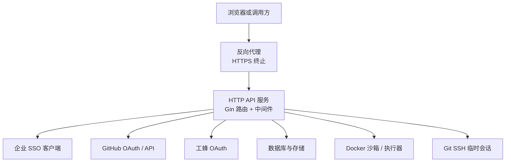

**图示来源**
- [internal/httpapi/server.go:202-225](file://internal/httpapi/server.go#L202-L225)
- [internal/httpapi/auth.go:39-77](file://internal/httpapi/auth.go#L39-L77)
- [internal/httpapi/github_auth.go:124-153](file://internal/httpapi/github_auth.go#L124-L153)
- [internal/httpapi/gongfeng_oauth.go:79-125](file://internal/httpapi/gongfeng_oauth.go#L79-L125)
- [internal/gitwork/ssh.go:216-252](file://internal/gitwork/ssh.go#L216-L252)

**章节来源**
- [internal/httpapi/server.go:202-225](file://internal/httpapi/server.go#L202-L225)
- [docs/deployment.md:69-76](file://docs/deployment.md#L69-L76)

## 核心安全组件
本节梳理 LoopForge 的关键安全能力及其实现位置。

| 安全主题 | 关键行为 | 对应实现 |
|---|---|---|
| 本地认证 | 同源 Origin 校验、请求体大小限制、IP 级暴力破解限速、最小错误信息 | [internal/httpapi/auth_password.go](file://internal/httpapi/auth_password.go) |
| 本地注册 | 用户名正则、密码长度校验、首次管理员逻辑、注册开关 | [internal/httpapi/auth_register.go](file://internal/httpapi/auth_register.go) |
| 会话 Cookie | HttpOnly、SameSite Lax、Secure 条件启用、最长 7 天会话、Domain 适配 AppDomain | [internal/httpapi/auth.go](file://internal/httpapi/auth.go) |
| 企业 SSO | 环境变量驱动、SessionSecret、LoginURL、头像获取、回跳地址校验 | [internal/auth/client.go](file://internal/auth/client.go)、[internal/httpapi/auth.go](file://internal/httpapi/auth.go) |
| GitHub OAuth | Device Flow、非过期 Token 校验、仓库列表拉取、限流与冲突处理 | [internal/httpapi/github_auth.go](file://internal/httpapi/github_auth.go) |
| 工蜂 OAuth | State HMAC 签名、回调校验、账号一致性检查、返回页同源 | [internal/httpapi/gongfeng_oauth.go](file://internal/httpapi/gongfeng_oauth.go) |
| 网关透传身份 | 仅 loopback、可选 Secret、拒绝带转发头请求 | [internal/httpapi/auth.go](file://internal/httpapi/auth.go)、[docs/deployment.md](file://docs/deployment.md) |
| 安全响应头 | X-Content-Type-Options、Referrer-Policy、CSP 等 | [internal/httpapi/gin_helpers.go](file://internal/httpapi/gin_helpers.go) |
| CORS | 严格同源校验、OPTIONS 预检 | [internal/httpapi/gin_helpers.go](file://internal/httpapi/gin_helpers.go) |
| Git SSH 安全 | 临时目录、禁止 Agent 转发、StrictHostKeyChecking、KnownHosts 固定 | [internal/gitwork/ssh.go](file://internal/gitwork/ssh.go) |

**章节来源**
- [internal/httpapi/auth_password.go:17-35](file://internal/httpapi/auth_password.go#L17-L35)
- [internal/httpapi/auth_register.go:24-32](file://internal/httpapi/auth_register.go#L24-L32)
- [internal/httpapi/auth.go:21-33](file://internal/httpapi/auth.go#L21-L33)
- [internal/auth/client.go:40-51](file://internal/auth/client.go#L40-L51)
- [internal/httpapi/github_auth.go:155-220](file://internal/httpapi/github_auth.go#L155-L220)
- [internal/httpapi/gongfeng_oauth.go:150-188](file://internal/httpapi/gongfeng_oauth.go#L150-L188)
- [internal/httpapi/gin_helpers.go:103-125](file://internal/httpapi/gin_helpers.go#L103-L125)
- [internal/gitwork/ssh.go:227-247](file://internal/gitwork/ssh.go#L227-L247)

## 架构总览
下图展示一次典型的企业 SSO 登录流程，以及 Cookie 与受保护接口的交互。

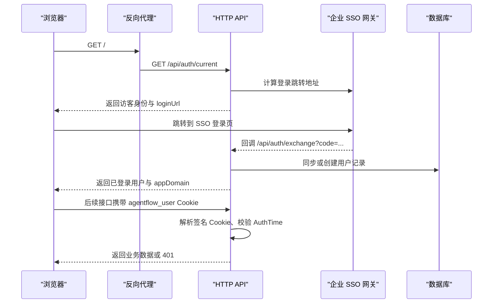

**图示来源**
- [internal/httpapi/auth.go:120-170](file://internal/httpapi/auth.go#L120-L170)
- [internal/httpapi/auth.go:212-282](file://internal/httpapi/auth.go#L212-L282)
- [internal/httpapi/auth.go:326-345](file://internal/httpapi/auth.go#L326-L345)

**章节来源**
- [internal/httpapi/auth.go:120-170](file://internal/httpapi/auth.go#L120-L170)
- [internal/httpapi/auth.go:212-282](file://internal/httpapi/auth.go#L212-L282)

## 详细组件分析

### 本地认证与注册
本地认证要求浏览器同源请求，防止通过代理伪造 Origin；注册同样需要同源校验。两者共享基于 IP 的暴力破解预算，每分钟最多尝试次数有限制，且同时限制追踪的 IP 数量，避免内存膨胀。

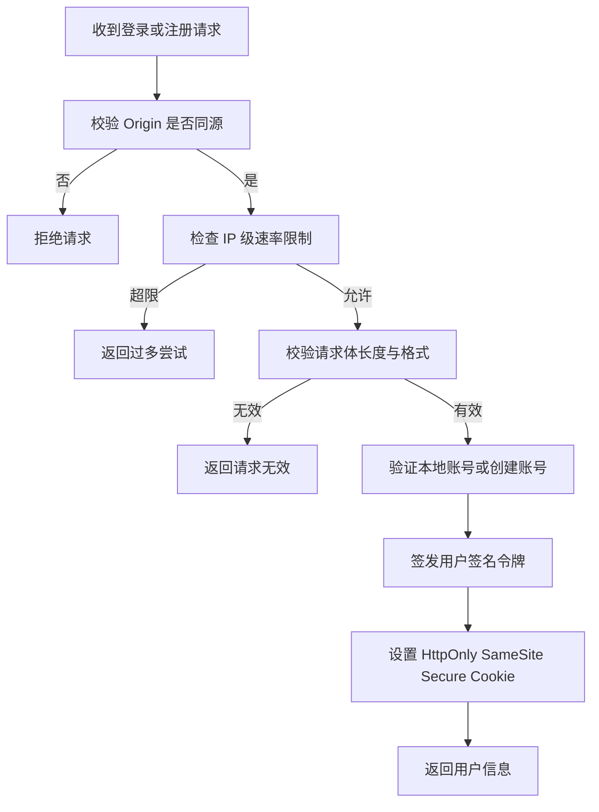

**图示来源**
- [internal/httpapi/auth_password.go:81-115](file://internal/httpapi/auth_password.go#L81-L115)
- [internal/httpapi/auth_register.go:61-119](file://internal/httpapi/auth_register.go#L61-L119)
- [internal/httpapi/auth.go:326-345](file://internal/httpapi/auth.go#L326-L345)

**章节来源**
- [internal/httpapi/auth_password.go:17-35](file://internal/httpapi/auth_password.go#L17-L35)
- [internal/httpapi/auth_password.go:81-115](file://internal/httpapi/auth_password.go#L81-L115)
- [internal/httpapi/auth_register.go:24-32](file://internal/httpapi/auth_register.go#L24-L32)
- [internal/httpapi/auth_register.go:61-119](file://internal/httpapi/auth_register.go#L61-L119)

### GitHub OAuth 集成
LoopForge 使用 GitHub Device Flow，无需用户手动填写 PAT；管理员可配置 OAuth App 的 Client ID。流程包括设备码申请、轮询获取 Access Token、校验 Token 不过期、保存 Git Token 并拉取仓库列表。

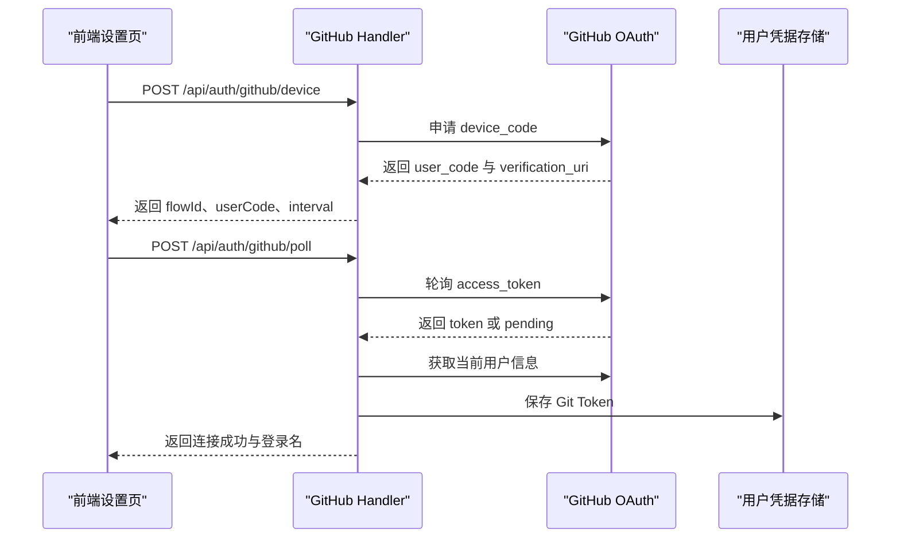

**图示来源**
- [internal/httpapi/github_auth.go:155-220](file://internal/httpapi/github_auth.go#L155-L220)
- [internal/httpapi/github_auth.go:222-311](file://internal/httpapi/github_auth.go#L222-L311)
- [internal/httpapi/github_auth.go:313-341](file://internal/httpapi/github_auth.go#L313-L341)

**章节来源**
- [internal/httpapi/github_auth.go:33-44](file://internal/httpapi/github_auth.go#L33-L44)
- [internal/httpapi/github_auth.go:80-122](file://internal/httpapi/github_auth.go#L80-L122)
- [internal/httpapi/github_auth.go:155-220](file://internal/httpapi/github_auth.go#L155-L220)
- [internal/httpapi/github_auth.go:222-311](file://internal/httpapi/github_auth.go#L222-L311)

### 工蜂 OAuth 与企业 SSO
工蜂 OAuth 使用平台 SessionSecret 对 state 进行 HMAC 签名，回调时校验状态、code、当前平台用户与工蜂账号一致性。企业 SSO 通过环境变量配置 AuthHost、AuthURI、PhotoURI、AppDomain、LoginURL 和 SessionSecret；若未配置外部 SSO，则回退到本地头像生成。

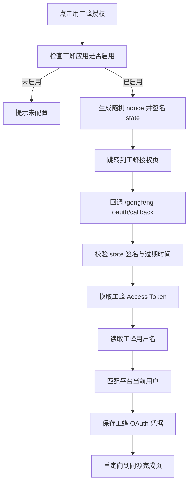

**图示来源**
- [internal/httpapi/gongfeng_oauth.go:41-77](file://internal/httpapi/gongfeng_oauth.go#L41-L77)
- [internal/httpapi/gongfeng_oauth.go:79-125](file://internal/httpapi/gongfeng_oauth.go#L79-L125)
- [internal/httpapi/gongfeng_oauth.go:150-188](file://internal/httpapi/gongfeng_oauth.go#L150-L188)
- [internal/auth/client.go:101-111](file://internal/auth/client.go#L101-L111)

**章节来源**
- [internal/httpapi/gongfeng_oauth.go:24-39](file://internal/httpapi/gongfeng_oauth.go#L24-L39)
- [internal/httpapi/gongfeng_oauth.go:41-77](file://internal/httpapi/gongfeng_oauth.go#L41-L77)
- [internal/httpapi/gongfeng_oauth.go:79-125](file://internal/httpapi/gongfeng_oauth.go#L79-L125)
- [internal/auth/client.go:40-51](file://internal/auth/client.go#L40-L51)
- [internal/auth/client.go:101-111](file://internal/auth/client.go#L101-L111)

### 企业 SSO 网关透传身份
当启用 `AGENTFLOW_TRUST_IDENTITY_HEADERS=true` 时，API 接受来自 loopback 的企业员工身份 Header。若配置了 `AGENTFLOW_IDENTITY_HEADER_SECRET`，则必须携带相同 Secret；否则任何携带转发头的请求都会被拒绝。该机制用于企业网关直接签发用户身份，但仍需配合反向代理与最小权限策略。

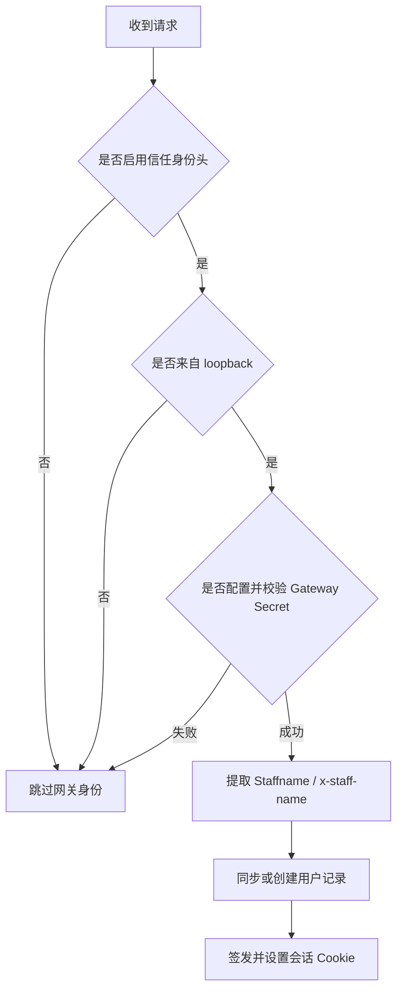

**图示来源**
- [internal/httpapi/auth.go:39-69](file://internal/httpapi/auth.go#L39-L69)
- [internal/httpapi/auth.go:212-235](file://internal/httpapi/auth.go#L212-L235)
- [docs/deployment.md:69-72](file://docs/deployment.md#L69-L72)

**章节来源**
- [internal/httpapi/auth.go:39-69](file://internal/httpapi/auth.go#L39-L69)
- [internal/httpapi/auth.go:212-235](file://internal/httpapi/auth.go#L212-L235)
- [docs/deployment.md:69-72](file://docs/deployment.md#L69-L72)

### HTTPS、SSL/TLS 与 Cookie 安全
LoopForge 自身不强制 TLS，但会根据请求是否 TLS、`X-Forwarded-Proto=https` 或 `AGENTFLOW_SECURE_COOKIES` 决定是否设置 Cookie 的 Secure 标志。生产环境应在反向代理处终止 HTTPS，并确保所有敏感 Cookie 仅通过 HTTPS 传输。

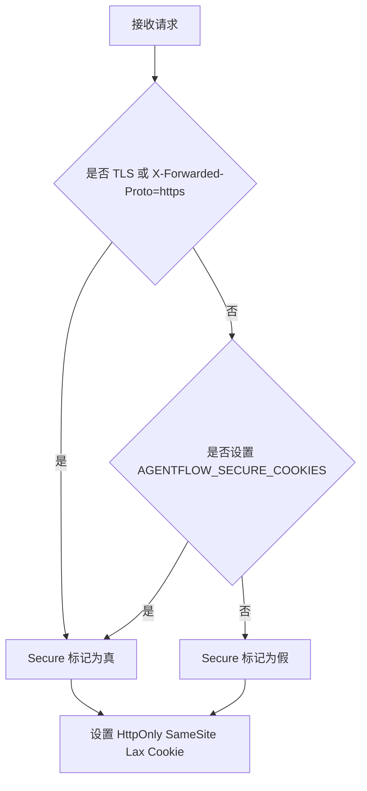

**图示来源**
- [internal/httpapi/auth.go:71-77](file://internal/httpapi/auth.go#L71-L77)
- [internal/httpapi/auth.go:326-345](file://internal/httpapi/auth.go#L326-L345)

**章节来源**
- [internal/httpapi/auth.go:71-77](file://internal/httpapi/auth.go#L71-L77)
- [internal/httpapi/auth.go:326-345](file://internal/httpapi/auth.go#L326-L345)

### 安全响应头与 CORS
HTTP API 中间件统一设置安全响应头，包括禁止 MIME 嗅探、严格的 Referrer-Policy、CSP 等；CORS 仅允许同源请求，OPTIONS 预检直接返回 204。

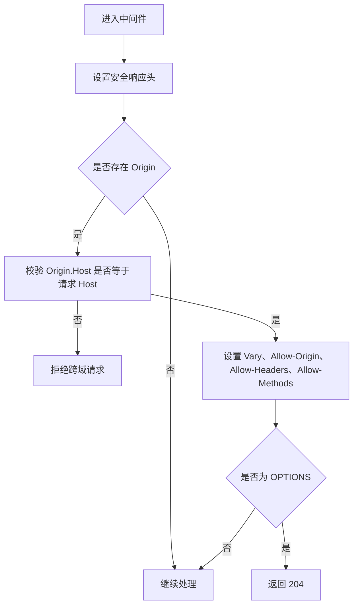

**图示来源**
- [internal/httpapi/gin_helpers.go:103-125](file://internal/httpapi/gin_helpers.go#L103-L125)
- [internal/httpapi/gin_helpers.go:127-140](file://internal/httpapi/gin_helpers.go#L127-L140)

**章节来源**
- [internal/httpapi/gin_helpers.go:103-125](file://internal/httpapi/gin_helpers.go#L103-L125)
- [internal/httpapi/gin_helpers.go:127-140](file://internal/httpapi/gin_helpers.go#L127-L140)

### 输入校验与防注入
LoopForge 在多处入口限制请求体大小，并对 JSON 解码失败返回明确错误。浏览器开发服务器代理会过滤危险响应头，重写 Location 与 Set-Cookie，避免将内部敏感头泄露给前端。

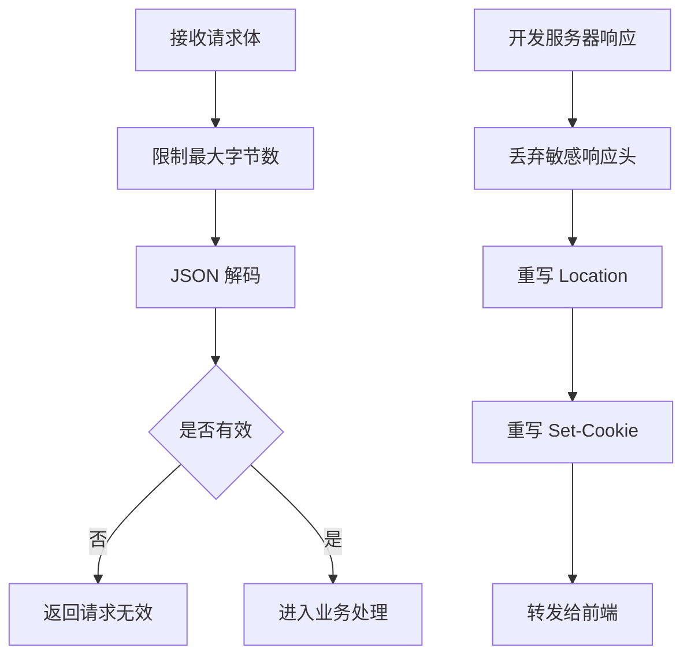

**图示来源**
- [internal/httpapi/gin_helpers.go:90-99](file://internal/httpapi/gin_helpers.go#L90-L99)
- [internal/httpapi/browser_devserver.go:331-367](file://internal/httpapi/browser_devserver.go#L331-L367)

**章节来源**
- [internal/httpapi/gin_helpers.go:90-99](file://internal/httpapi/gin_helpers.go#L90-L99)
- [internal/httpapi/browser_devserver.go:331-367](file://internal/httpapi/browser_devserver.go#L331-L367)

### Git SSH 安全与执行隔离
每次 Git 操作会生成临时 SSH 配置，仅允许指定主机密钥别名，禁用 Agent 转发、全局 known_hosts 与 StrictHostKeyChecking 关闭以外的风险项，并使用临时进程内 keyring 加载私钥。

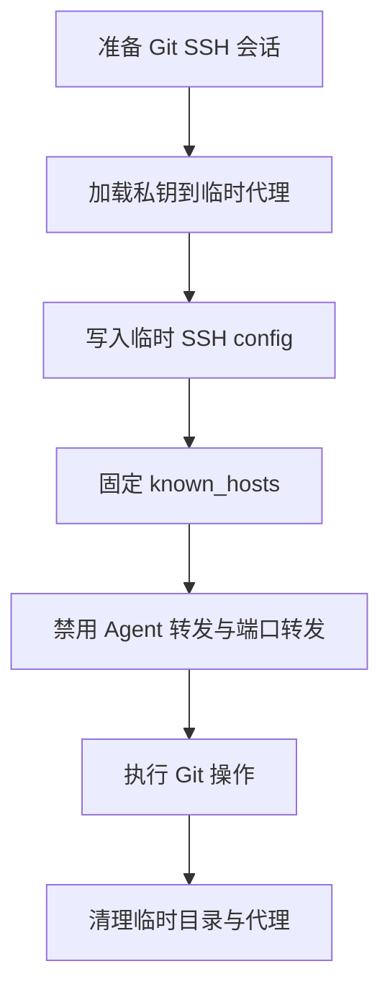

**图示来源**
- [internal/gitwork/ssh.go:216-252](file://internal/gitwork/ssh.go#L216-L252)

**章节来源**
- [internal/gitwork/ssh.go:216-252](file://internal/gitwork/ssh.go#L216-L252)

## 依赖关系分析
HTTP API 服务装配多个 handler，并通过 deps 共享 repo、engine、authClient、schedule 等依赖。认证相关 handler 依赖 auth.Client 进行签名与解析；GitHub 与工蜂 OAuth 分别依赖外部 OAuth 服务；Git SSH 依赖系统 SSH 工具链。

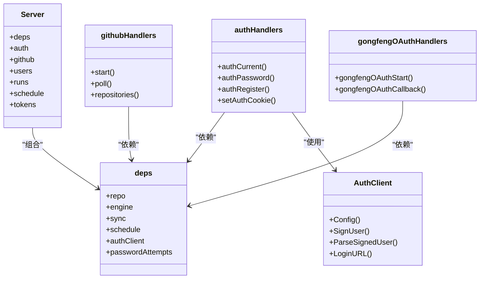

**图示来源**
- [internal/httpapi/server.go:38-96](file://internal/httpapi/server.go#L38-L96)
- [internal/httpapi/auth.go:35-37](file://internal/httpapi/auth.go#L35-L37)
- [internal/httpapi/github_auth.go:35-44](file://internal/httpapi/github_auth.go#L35-L44)
- [internal/httpapi/gongfeng_oauth.go:28-39](file://internal/httpapi/gongfeng_oauth.go#L28-L39)
- [internal/auth/client.go:53-58](file://internal/auth/client.go#L53-L58)

**章节来源**
- [internal/httpapi/server.go:38-96](file://internal/httpapi/server.go#L38-L96)
- [internal/httpapi/auth.go:35-37](file://internal/httpapi/auth.go#L35-L37)
- [internal/httpapi/github_auth.go:35-44](file://internal/httpapi/github_auth.go#L35-L44)
- [internal/httpapi/gongfeng_oauth.go:28-39](file://internal/httpapi/gongfeng_oauth.go#L28-L39)
- [internal/auth/client.go:53-58](file://internal/auth/client.go#L53-L58)

## 性能与可用性考虑
- 会话 Cookie 最长有效期为 7 天，避免长期驻留导致“半失效”状态。
- GitHub Device Flow 轮询间隔动态调整，slow_down 时增加等待时间。
- Gin 中间件对非流式响应启用 Gzip，减少带宽占用。
- 暴力破解限速按 IP 维度统计，避免单实例被大量来源耗尽资源。

**章节来源**
- [internal/httpapi/auth.go:23-33](file://internal/httpapi/auth.go#L23-L33)
- [internal/httpapi/github_auth.go:288-294](file://internal/httpapi/github_auth.go#L288-L294)
- [internal/httpapi/gin_helpers.go:190-207](file://internal/httpapi/gin_helpers.go#L190-L207)
- [internal/httpapi/auth_password.go:17-35](file://internal/httpapi/auth_password.go#L17-L35)

## 故障排查指南
常见问题与定位要点：
- 登录后仍显示访客：检查 `/api/auth/current` 返回的 loginUrl 与 Cookie 是否设置；确认 `AGENTFLOW_SECURE_COOKIES` 与反向代理是否正确传递 `X-Forwarded-Proto`。
- 企业 SSO 无法登录：确认 `AGENTFLOW_TRUST_IDENTITY_HEADERS` 与 `AGENTFLOW_IDENTITY_HEADER_SECRET` 配置一致；检查网关是否覆盖转发头。
- GitHub 授权失败：检查 OAuth App 是否启用 Device Flow、Client ID 是否配置、Access Token 是否设置为非过期。
- 工蜂 OAuth 回调失败：检查 state 签名、回调 URL 同源、平台用户与工蜂账号是否一致。
- 跨域请求被拒：检查 Origin 是否与 Host 一致；确认 CORS 中间件生效。
- Git SSH 连接失败：检查临时 SSH 配置、known_hosts 是否固定、是否启用了不允许的转发。

**章节来源**
- [internal/httpapi/auth.go:120-170](file://internal/httpapi/auth.go#L120-L170)
- [internal/httpapi/auth.go:212-282](file://internal/httpapi/auth.go#L212-L282)
- [docs/deployment.md:69-72](file://docs/deployment.md#L69-L72)
- [internal/httpapi/github_auth.go:155-220](file://internal/httpapi/github_auth.go#L155-L220)
- [internal/httpapi/gongfeng_oauth.go:79-125](file://internal/httpapi/gongfeng_oauth.go#L79-L125)
- [internal/httpapi/gin_helpers.go:103-125](file://internal/httpapi/gin_helpers.go#L103-L125)
- [internal/gitwork/ssh.go:216-252](file://internal/gitwork/ssh.go#L216-L252)

## 结论
LoopForge 在认证、授权、会话、输入校验、CORS、安全响应头、Git SSH 与外部 OAuth 集成方面提供了较完整的安全基线。生产部署应优先完成 HTTPS、最小权限、防火墙与沙箱隔离，并结合企业 SSO 与审计监控提升整体安全性。安全策略应以“默认拒绝、最小暴露、可观测可恢复”为原则。

## 附录：部署与合规清单
- 认证与授权
  - 启用本地管理员账户后关闭自助注册：`AGENTFLOW_ALLOW_SIGNUP=false`。
  - 配置企业 SSO：`AGENTFLOW_SSO_PAAS_ID`、`AGENTFLOW_SSO_APP_TOKEN`、`AGENTFLOW_SSO_AUTH_HOST`、`AGENTFLOW_SSO_AUTH_URI`、`AGENTFLOW_SSO_PHOTO_URI`、`AGENTFLOW_SSO_LOGIN_URL`、`AGENTFLOW_SSO_SESSION_SECRET`。
  - 启用网关透传身份时需设置 `AGENTFLOW_TRUST_IDENTITY_HEADERS=true` 与 `AGENTFLOW_IDENTITY_HEADER_SECRET`。
  - GitHub OAuth：配置 `AGENTFLOW_GITHUB_CLIENT_ID`，启用 Device Flow，关闭 Access Token 过期。
  - 工蜂 OAuth：配置 Client ID、Secret、RedirectURI，确保回调同源。
- HTTPS 与 Cookie
  - 在反向代理终止 TLS，设置 `X-Forwarded-Proto=https`。
  - 如需强制 Secure Cookie，设置 `AGENTFLOW_SECURE_COOKIES=true`。
  - 确保 Cookie Domain 与 AppDomain 一致，避免跨域 Cookie 泄漏。
- 防火墙与网络隔离
  - 仅开放必要端口，限制来源 IP。
  - 沙箱使用 Docker 或 native 隔离，避免宿主机直连。
  - 执行器与平台之间使用一次性绑定码或 runner session token。
- 审计与监控
  - 开启日志与遥测，关注 `/api/health`、`/api/observability/spec`、`/api/otel/*path`。
  - 对异常登录、授权失败、GitHub/工蜂回调错误进行告警。
- 常见漏洞防护
  - 开放重定向：使用站内相对路径与 allowedReturnHost 校验。
  - CSRF：SameSite Lax + Secure + HttpOnly。
  - XSS：X-Content-Type-Options nosniff + CSP。
  - 暴力破解：IP 级速率限制。
  - 越权访问：用户令牌访问控制、最小权限原则。

**章节来源**
- [internal/httpapi/auth_register.go:24-32](file://internal/httpapi/auth_register.go#L24-L32)
- [internal/auth/client.go:101-111](file://internal/auth/client.go#L101-L111)
- [docs/deployment.md:69-72](file://docs/deployment.md#L69-L72)
- [internal/httpapi/github_auth.go:80-122](file://internal/httpapi/github_auth.go#L80-L122)
- [internal/httpapi/gongfeng_oauth.go:41-77](file://internal/httpapi/gongfeng_oauth.go#L41-L77)
- [internal/httpapi/auth.go:71-77](file://internal/httpapi/auth.go#L71-L77)
- [internal/httpapi/gin_helpers.go:127-140](file://internal/httpapi/gin_helpers.go#L127-L140)
- [internal/httpapi/auth_password.go:17-35](file://internal/httpapi/auth_password.go#L17-L35)