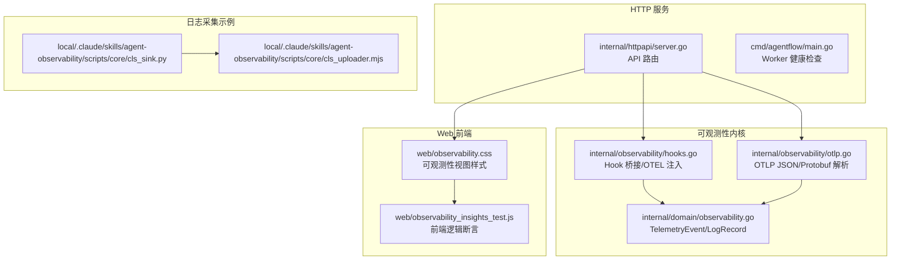
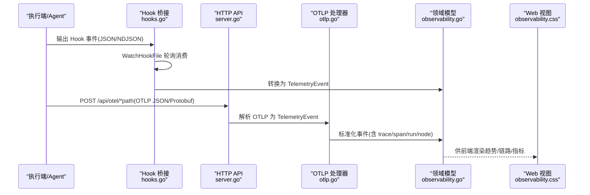
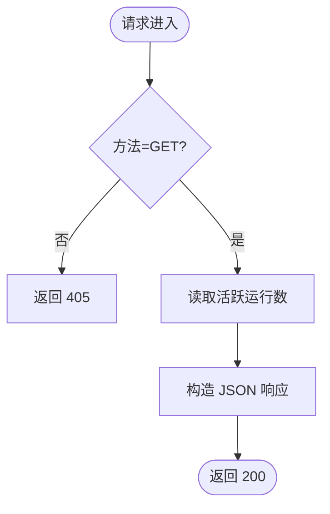
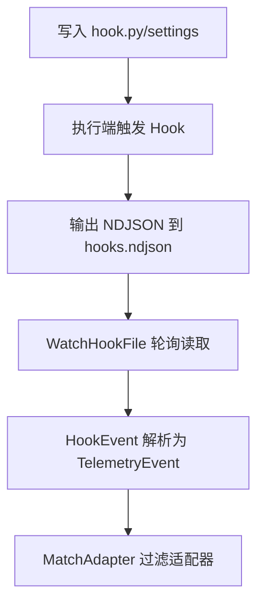
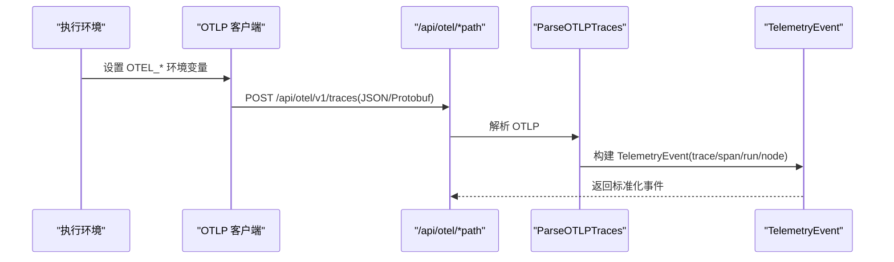
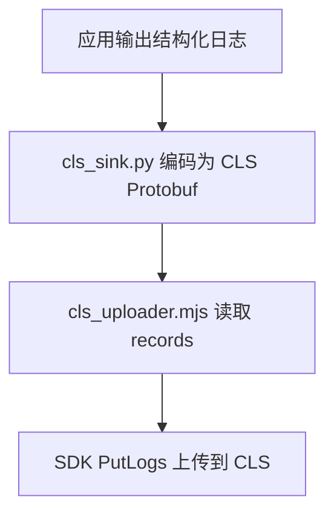
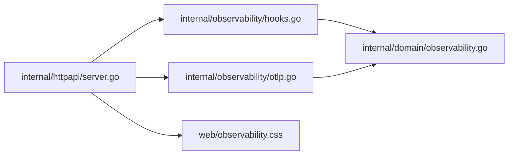

# 监控与日志

<cite>
**本文引用的文件**   
- [internal/httpapi/server.go](file://internal/httpapi/server.go)
- [cmd/agentflow/main.go](file://cmd/agentflow/main.go)
- [internal/observability/hooks.go](file://internal/observability/hooks.go)
- [internal/observability/otlp.go](file://internal/observability/otlp.go)
- [internal/domain/observability.go](file://internal/domain/observability.go)
- [web/observability.css](file://web/observability.css)
- [web/observability_insights_test.js](file://web/observability_insights_test.js)
- [local/.claude/skills/agent-observability/scripts/core/cls_sink.py](file://local/.claude/skills/agent-observability/scripts/core/cls_sink.py)
- [local/.claude/skills/agent-observability/scripts/core/cls_uploader.mjs](file://local/.claude/skills/agent-observability/scripts/core/cls_uploader.mjs)
</cite>

## 目录
1. [简介](#简介)
2. [项目结构](#项目结构)
3. [核心组件](#核心组件)
4. [架构总览](#架构总览)
5. [详细组件分析](#详细组件分析)
6. [依赖关系分析](#依赖关系分析)
7. [性能考虑](#性能考虑)
8. [故障诊断指南](#故障诊断指南)
9. [结论](#结论)
10. [附录](#附录)

## 简介
本文件面向 LoopForge 的“监控与日志”能力，覆盖健康检查、指标与业务观测、结构化日志、OpenTelemetry 集成与分布式追踪、以及可观测性数据在平台侧的汇聚与展示。文档同时给出 Prometheus/Grafana/ELK Stack 等监控系统的集成思路、告警规则建议与通知机制设计，并附带故障诊断工具与调试技巧。

## 项目结构
LoopForge 的可观测性相关代码主要分布在以下位置：
- HTTP API 路由与健康检查：internal/httpapi/server.go、cmd/agentflow/main.go
- OpenTelemetry 接入与 OTLP 解析：internal/observability/hooks.go、internal/observability/otlp.go
- 领域模型（遥测事件、日志记录）：internal/domain/observability.go
- Web 前端可观测性视图样式与测试：web/observability.css、web/observability_insights_test.js
- 日志采集与上传（CLS 示例）：local/.claude/skills/agent-observability/scripts/core/cls_sink.py、local/.claude/skills/agent-observability/scripts/core/cls_uploader.mjs

图表来源
- [internal/httpapi/server.go:230-250](file://internal/httpapi/server.go#L230-L250)
- [cmd/agentflow/main.go:360-377](file://cmd/agentflow/main.go#L360-L377)
- [internal/observability/hooks.go:25-72](file://internal/observability/hooks.go#L25-L72)
- [internal/observability/otlp.go:59-101](file://internal/observability/otlp.go#L59-L101)
- [internal/domain/observability.go:120-141](file://internal/domain/observability.go#L120-L141)
- [web/observability.css:408-496](file://web/observability.css#L408-L496)
- [web/observability_insights_test.js:1-27](file://web/observability_insights_test.js#L1-L27)
- [local/.claude/skills/agent-observability/scripts/core/cls_sink.py:138-176](file://local/.claude/skills/agent-observability/scripts/core/cls_sink.py#L138-L176)
- [local/.claude/skills/agent-observability/scripts/core/cls_uploader.mjs:49-96](file://local/.claude/skills/agent-observability/scripts/core/cls_uploader.mjs#L49-L96)

章节来源
- [internal/httpapi/server.go:230-250](file://internal/httpapi/server.go#L230-L250)
- [cmd/agentflow/main.go:360-377](file://cmd/agentflow/main.go#L360-L377)

## 核心组件
- 健康检查端点
  - 主服务暴露 /api/health，用于整体健康探测。
  - Worker 进程也提供 /api/health，返回角色与活跃运行数，便于编排层判断节点状态。
- 遥测与日志
  - Hook 桥接：将 CodeBuddy/Hook 输出写入 NDJSON，并由 WatchHookFile 轮询消费，转换为 TelemetryEvent。
  - OpenTelemetry：通过环境变量注入 OTEL 导出器，统一上报到 /api/otel/*path；服务端支持 JSON 与 Protobuf 两种 OTLP 格式解析。
  - 领域模型：TelemetryEvent 与 LogRecord 作为统一的遥测与日志数据结构。
- Web 可观测性视图
  - 提供可观测性页面的样式与交互基础，配合后端指标与遥测数据进行可视化。

章节来源
- [internal/httpapi/server.go:230-250](file://internal/httpapi/server.go#L230-L250)
- [cmd/agentflow/main.go:360-377](file://cmd/agentflow/main.go#L360-L377)
- [internal/observability/hooks.go:25-72](file://internal/observability/hooks.go#L25-L72)
- [internal/observability/hooks.go:271-316](file://internal/observability/hooks.go#L271-L316)
- [internal/observability/otlp.go:59-101](file://internal/observability/otlp.go#L59-L101)
- [internal/domain/observability.go:120-141](file://internal/domain/observability.go#L120-L141)
- [web/observability.css:408-496](file://web/observability.css#L408-L496)

## 架构总览
下图展示了从执行端到平台侧的遥测与日志流转路径，包括 Hook 桥接、OTLP 接收、解析与领域模型映射。

图表来源
- [internal/observability/hooks.go:271-316](file://internal/observability/hooks.go#L271-L316)
- [internal/httpapi/server.go:483-490](file://internal/httpapi/server.go#L483-L490)
- [internal/observability/otlp.go:59-101](file://internal/observability/otlp.go#L59-L101)
- [internal/domain/observability.go:120-141](file://internal/domain/observability.go#L120-L141)
- [web/observability.css:408-496](file://web/observability.css#L408-L496)

## 详细组件分析

### 健康检查端点
- 主服务 /api/health
  - 由 HTTP API 路由注册，对外暴露健康检查能力。
- Worker /api/health
  - 返回 worker 角色与当前活跃运行数量，便于调度或负载均衡器进行健康判定。

图表来源
- [cmd/agentflow/main.go:360-377](file://cmd/agentflow/main.go#L360-L377)

章节来源
- [internal/httpapi/server.go:230-250](file://internal/httpapi/server.go#L230-L250)
- [cmd/agentflow/main.go:360-377](file://cmd/agentflow/main.go#L360-L377)

### Hook 桥接与结构化日志
- Hook 脚本生成
  - 自动写入 hook.py 与 codebuddy-settings.json，定义 SessionStart/UserPromptSubmit/PreToolUse/PostToolUse/Stop 等钩子，并将输出追加到 hooks.ndjson。
- 文件监听与事件转换
  - WatchHookFile 定时扫描 hooks.ndjson，将每行 NDJSON 解析为 domain.TelemetryEvent，包含类别、名称、阶段、级别、消息、会话/工具上下文与属性。
- 适配器过滤
  - MatchAdapter 支持按适配器类型过滤（如 hooks、otel、live），便于前端或下游系统筛选不同来源的事件。

图表来源
- [internal/observability/hooks.go:25-72](file://internal/observability/hooks.go#L25-L72)
- [internal/observability/hooks.go:271-316](file://internal/observability/hooks.go#L271-L316)
- [internal/observability/hooks.go:338-352](file://internal/observability/hooks.go#L338-L352)

章节来源
- [internal/observability/hooks.go:25-72](file://internal/observability/hooks.go#L25-L72)
- [internal/observability/hooks.go:271-316](file://internal/observability/hooks.go#L271-L316)
- [internal/observability/hooks.go:338-352](file://internal/observability/hooks.go#L338-L352)

### OpenTelemetry 集成与分布式追踪
- 环境变量注入
  - InjectCodeBuddyEnv 向执行环境注入 OTEL_TRACES_EXPORTER、OTEL_EXPORTER_OTLP_PROTOCOL、OTEL_EXPORTER_OTLP_TRACES_ENDPOINT、OTEL_RESOURCE_ATTRIBUTES 等变量，使执行端直接以 OTLP/HTTP+Protobuf 上报。
- CollectorTracesURL
  - 优先使用 AGENTFLOW_OTEL_TRACES_ENDPOINT，其次回退到 AGENTFLOW_OTEL_ENDPOINT，最终拼接 /v1/traces。
- OTLP 接收与解析
  - HTTP API 暴露 /api/otel/*path，接收 OTLP 数据。
  - ParseOTLPTraces 支持 JSON 与 Protobuf 两种格式，解析出 ResourceSpans/ScopeSpans/Spans，并映射为 TelemetryEvent，保留 traceId/spanId、run_id/node_id、span.type 等关键属性。
  - 对错误状态码与时间戳进行规范化处理，计算 durationMs。

图表来源
- [internal/observability/hooks.go:354-379](file://internal/observability/hooks.go#L354-L379)
- [internal/httpapi/server.go:483-490](file://internal/httpapi/server.go#L483-L490)
- [internal/observability/otlp.go:59-101](file://internal/observability/otlp.go#L59-L101)
- [internal/observability/otlp.go:103-163](file://internal/observability/otlp.go#L103-L163)

章节来源
- [internal/observability/hooks.go:354-379](file://internal/observability/hooks.go#L354-L379)
- [internal/httpapi/server.go:483-490](file://internal/httpapi/server.go#L483-L490)
- [internal/observability/otlp.go:59-101](file://internal/observability/otlp.go#L59-L101)
- [internal/observability/otlp.go:103-163](file://internal/observability/otlp.go#L103-L163)

### 指标与业务观测
- 指标与业务数据
  - 平台提供工作流指标、分析聚合等接口，例如 /api/workflow-metrics、/api/analytics，用于支撑可观测性面板的趋势、分布与归因分析。
- Web 可观测性视图
  - web/observability.css 定义了可观测性视图的布局与样式，配合前端逻辑（见 observability_insights_test.js）实现趋势、成本、用户用量等展示。

章节来源
- [internal/httpapi/server.go:483-490](file://internal/httpapi/server.go#L483-L490)
- [web/observability.css:408-496](file://web/observability.css#L408-L496)
- [web/observability_insights_test.js:1-27](file://web/observability_insights_test.js#L1-L27)

### 日志采集与上传（CLS 示例）
- cls_sink.py
  - 将结构化日志记录编码为 CLS 简化 Protobuf，支持时间戳、service_name 与键值字段，适合批量写入本地文件或管道。
- cls_uploader.mjs
  - 读取 stdin 中的 records，组装 LogGroup 并通过 SDK 调用 PutLogs 上传至 CLS 服务。

图表来源
- [local/.claude/skills/agent-observability/scripts/core/cls_sink.py:138-176](file://local/.claude/skills/agent-observability/scripts/core/cls_sink.py#L138-L176)
- [local/.claude/skills/agent-observability/scripts/core/cls_uploader.mjs:49-96](file://local/.claude/skills/agent-observability/scripts/core/cls_uploader.mjs#L49-L96)

章节来源
- [local/.claude/skills/agent-observability/scripts/core/cls_sink.py:138-176](file://local/.claude/skills/agent-observability/scripts/core/cls_sink.py#L138-L176)
- [local/.claude/skills/agent-observability/scripts/core/cls_uploader.mjs:49-96](file://local/.claude/skills/agent-observability/scripts/core/cls_uploader.mjs#L49-L96)

## 依赖关系分析
- HTTP API 依赖 observability 模块进行 OTLP 解析与 Hook 桥接。
- observability 模块依赖 domain 领域模型，将外部数据标准化为 TelemetryEvent/LogRecord。
- Web 前端依赖后端提供的指标与遥测数据，并以 CSS 样式呈现可观测性视图。

图表来源
- [internal/httpapi/server.go:483-490](file://internal/httpapi/server.go#L483-L490)
- [internal/observability/hooks.go:25-72](file://internal/observability/hooks.go#L25-L72)
- [internal/observability/otlp.go:59-101](file://internal/observability/otlp.go#L59-L101)
- [internal/domain/observability.go:120-141](file://internal/domain/observability.go#L120-L141)
- [web/observability.css:408-496](file://web/observability.css#L408-L496)

章节来源
- [internal/httpapi/server.go:483-490](file://internal/httpapi/server.go#L483-L490)
- [internal/observability/hooks.go:25-72](file://internal/observability/hooks.go#L25-L72)
- [internal/observability/otlp.go:59-101](file://internal/observability/otlp.go#L59-L101)
- [internal/domain/observability.go:120-141](file://internal/domain/observability.go#L120-L141)
- [web/observability.css:408-496](file://web/observability.css#L408-L496)

## 性能考虑
- OTLP 解析
  - 支持 JSON 与 Protobuf 双通道，Protobuf 解析采用轻量级字段遍历，遇到畸形字段时静默跳过已解析部分，避免整包失败。
- Hook 文件监听
  - 使用定时器轮询 hooks.ndjson，缓冲读取大行，避免阻塞；合理设置轮询间隔与缓冲区大小，平衡实时性与开销。
- 资源属性合并
  - 将 Resource 属性合并到 Span 属性中，减少重复传输，提升查询效率。
- 时间戳与时长计算
  - 对 startTimeUnixNano/endTimeUnixNano 做多类型兼容解析，并在有效区间内计算 durationMs，便于指标聚合。

章节来源
- [internal/observability/otlp.go:59-101](file://internal/observability/otlp.go#L59-L101)
- [internal/observability/otlp.go:190-212](file://internal/observability/otlp.go#L190-L212)
- [internal/observability/hooks.go:271-316](file://internal/observability/hooks.go#L271-L316)

## 故障诊断指南
- 健康检查
  - 访问 /api/health 确认服务存活；Worker 模式下关注 activeRuns 是否为预期值。
- Hook 输出
  - 检查 .agentflow/observability/hooks.ndjson 是否存在且持续更新；若为空，确认 hook.py 是否被正确写入与执行。
- OTLP 上报
  - 验证 OTEL_* 环境变量是否正确注入；检查 /api/otel/*path 是否收到数据；确认 JSON/Protobuf 格式一致。
- 解析异常
  - 若 OTLP 数据无法解析，检查字段类型与时间戳格式；Protobuf 输入需符合 OTLP 规范。
- Web 视图
  - 确认 observability.css 与前端逻辑未被破坏；可通过 observability_insights_test.js 断言关键行为。

章节来源
- [cmd/agentflow/main.go:360-377](file://cmd/agentflow/main.go#L360-L377)
- [internal/observability/hooks.go:25-72](file://internal/observability/hooks.go#L25-L72)
- [internal/observability/otlp.go:59-101](file://internal/observability/otlp.go#L59-L101)
- [web/observability_insights_test.js:1-27](file://web/observability_insights_test.js#L1-L27)

## 结论
LoopForge 的可观测性体系以 HTTP API 为入口，结合 Hook 桥接与 OpenTelemetry 标准协议，将执行端的遥测与日志统一收敛为领域模型，再经由 Web 前端进行可视化。该设计兼顾了灵活性与可扩展性，既支持原生 Hook 生态，也兼容主流 OTLP 生态。在此基础上，可进一步对接 Prometheus/Grafana/ELK Stack 等监控系统，完善指标采集、日志检索与告警通知闭环。

## 附录

### 监控系统集成方案（Prometheus、Grafana、ELK Stack）
- Prometheus
  - 指标暴露：将 /api/workflow-metrics、/api/analytics 等接口数据定期拉取，或通过自定义 Exporter 将 TelemetryEvent 聚合为 Prometheus 指标（如请求量、延迟分位、错误率）。
  - 存储与查询：Prometheus 存储时序指标，Grafana 负责可视化与仪表盘。
- Grafana
  - 仪表盘：基于 Prometheus 数据源构建趋势图、热力图、漏斗图等；结合 TelemetryEvent 的 category/name/phase 维度进行多维分析。
- ELK Stack
  - 日志采集：使用 Filebeat/Fluent Bit 收集 hooks.ndjson 与应用日志，经 Logstash 清洗后写入 Elasticsearch。
  - 可视化：Kibana 提供日志检索、索引管理与告警规则配置。

[本节为概念性说明，不直接分析具体源码文件]

### 告警规则配置与通知机制
- 指标告警
  - 在 Prometheus 中定义规则（如错误率阈值、延迟 P99 超阈、活跃运行数异常），通过 Alertmanager 分发到邮件、企业微信、Slack 等渠道。
- 日志告警
  - 在 Kibana 中配置基于关键字或正则的日志告警规则，触发后通过 Webhook 或邮件通知。
- 链路告警
  - 基于 TelemetryEvent 的错误级别与 span.status.code，在平台侧或下游系统中实现链路级告警。

[本节为概念性说明，不直接分析具体源码文件]

### 调试技巧
- 启用 Hook 调试
  - 查看 hooks.ndjson 内容，确认事件结构与字段是否符合预期；必要时调整 Hook 脚本的输出格式。
- OTLP 抓包
  - 使用网络抓包工具捕获 /api/otel/*path 的请求体，校验 JSON/Protobuf 结构。
- 前端断言
  - 运行 observability_insights_test.js，确保前端逻辑与数据模型保持一致。

章节来源
- [internal/observability/hooks.go:271-316](file://internal/observability/hooks.go#L271-L316)
- [web/observability_insights_test.js:1-27](file://web/observability_insights_test.js#L1-L27)