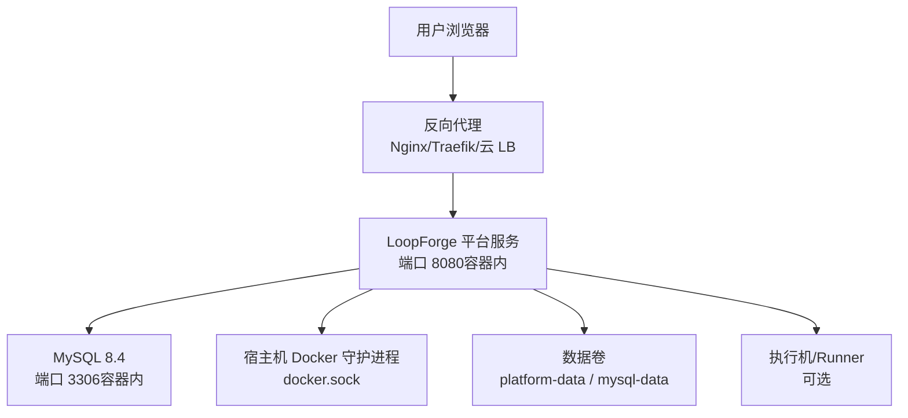
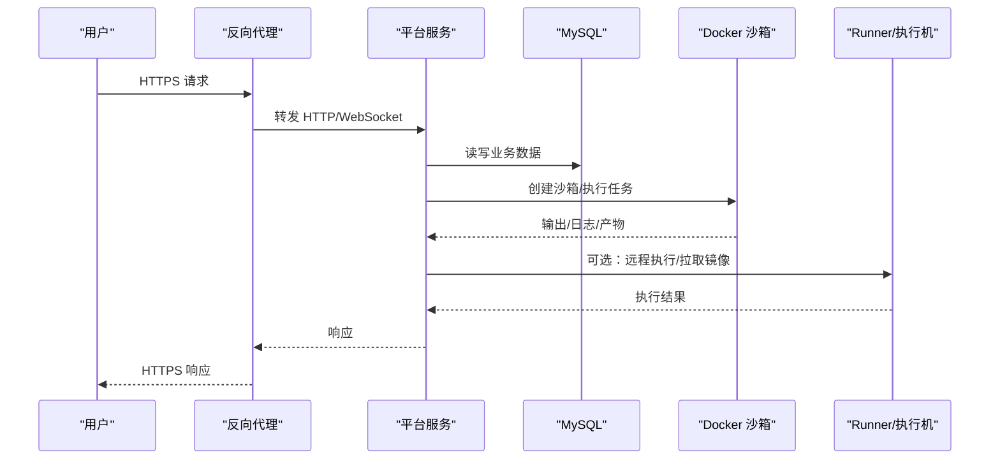
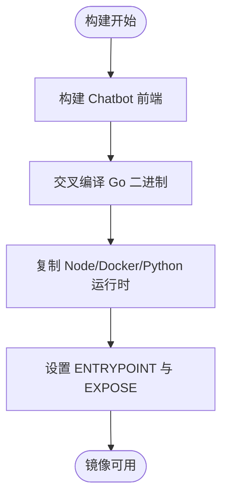
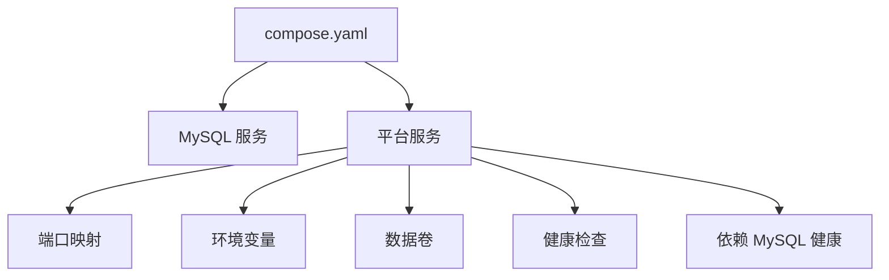
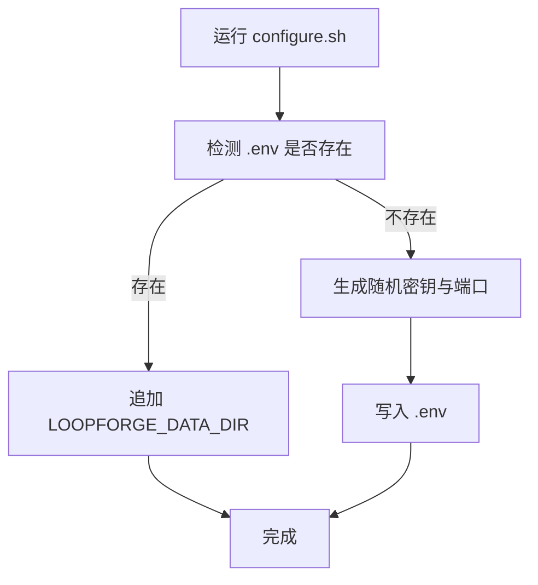
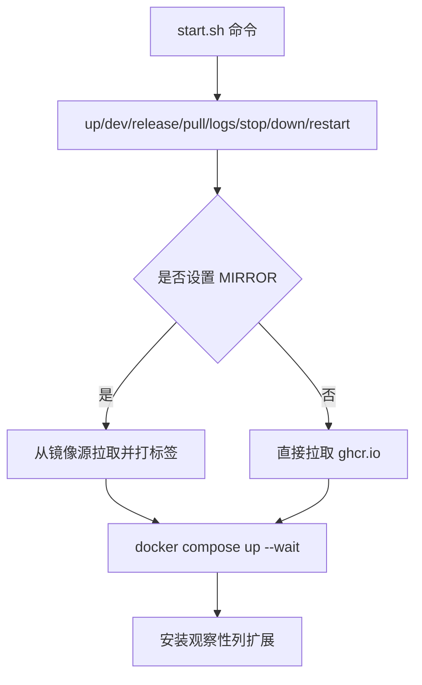
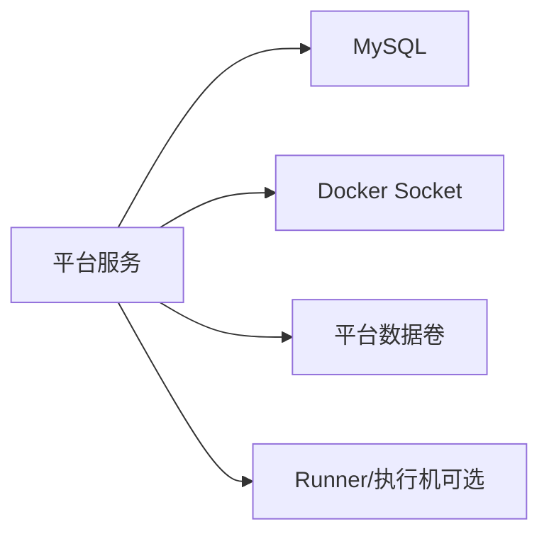
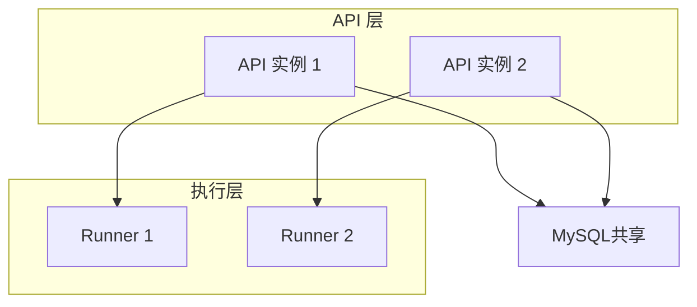
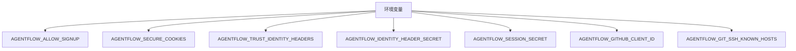

# 部署指南

<cite>
**本文引用的文件**   
- [README.md](file://README.md)
- [docs/deployment.md](file://docs/deployment.md)
- [compose.yaml](file://compose.yaml)
- [Dockerfile](file://Dockerfile)
- [start.sh](file://start.sh)
- [scripts/configure.sh](file://scripts/configure.sh)
- [internal/httpapi/auth.go](file://internal/httpapi/auth.go)
</cite>

## 目录
1. [简介](#简介)
2. [项目结构](#项目结构)
3. [核心组件](#核心组件)
4. [架构总览](#架构总览)
5. [详细组件分析](#详细组件分析)
6. [依赖关系分析](#依赖关系分析)
7. [性能与容量规划](#性能与容量规划)
8. [安全与合规配置](#安全与合规配置)
9. [监控、可观测性与日志](#监控可观测性与日志)
10. [备份、恢复与灾难恢复](#备份恢复与灾难恢复)
11. [故障排除](#故障排除)
12. [结论](#结论)

## 简介
本指南面向生产环境，覆盖 LoopForge 的单机、集群与云部署模式；说明 Docker Compose 配置、环境变量与安全设置；给出 HTTPS 与反向代理建议；并提供性能调优、监控、备份恢复与灾难恢复策略。LoopForge 默认通过 Docker Compose 提供 MySQL 与平台服务，支持在可信团队内自托管运行，并可通过外部 MySQL、独立 API/Worker 实例和连接执行机扩展为集群形态。

## 项目结构
从部署视角，关键文件如下：
- `compose.yaml`：定义 MySQL 与平台服务的容器编排、端口映射、数据卷、健康检查与依赖。
- `Dockerfile`：构建平台镜像，包含 Go 二进制、Node.js 运行时、内置 CLI、Python 工具链与 Docker CLI。
- `start.sh`：安装、启动、拉取镜像、查看日志、停止与重启等运维入口。
- `scripts/configure.sh`：生成 `.env`，注入数据库密码、会话密钥、绑定地址与公开 URL 等初始配置。
- `docs/deployment.md`：官方部署文档，涵盖原生开发、容器安装、沙箱、SSH、账户、工作器、迁移与升级。
- `internal/httpapi/auth.go`：实现网关身份信任、HTTPS Cookie 安全标志等安全逻辑。

**图表来源**
- [compose.yaml:3-67](file://compose.yaml#L3-L67)
- [Dockerfile:30-67](file://Dockerfile#L30-L67)

**章节来源**
- [compose.yaml:1-71](file://compose.yaml#L1-L71)
- [Dockerfile:1-68](file://Dockerfile#L1-L68)
- [start.sh:1-72](file://start.sh#L1-L72)
- [scripts/configure.sh:1-23](file://scripts/configure.sh#L1-L23)
- [docs/deployment.md:1-205](file://docs/deployment.md#L1-L205)

## 核心组件
- 平台服务：Go 后端，暴露 HTTP API，负责会话、项目、SOP、执行调度、MCP 集成与前端静态资源。
- MySQL：存储用户、项目、运行记录、沙箱与环境定义等数据。
- Docker 沙箱：默认通过宿主 Docker socket 启动隔离容器执行 SOP 与工作区任务。
- Runner/执行机：可选的外部执行节点，用于分担计算或访问受限网络。
- 反向代理：推荐在 HTTPS 终止后转发 WebSocket 与流式请求到平台。

**章节来源**
- [docs/deployment.md:24-67](file://docs/deployment.md#L24-L67)
- [compose.yaml:20-67](file://compose.yaml#L20-L67)

## 架构总览
LoopForge 的生产架构通常由“反向代理 + 平台服务 + MySQL”组成；需要 AI 执行能力时，平台通过 Docker 沙箱或直接调用 Runner/执行机完成代码克隆、构建、测试与提交。

**图表来源**
- [compose.yaml:20-67](file://compose.yaml#L20-L67)
- [docs/deployment.md:74-83](file://docs/deployment.md#L74-L83)

## 详细组件分析

### 容器化与镜像
- 镜像入口为 `/app/bin/agentflow`，默认监听容器内 `8080`。
- 镜像预装 Node.js、Git、OpenSSH、Python 3、Docker CLI 与若干 CLI 工具，便于沙箱与工具链使用。
- 多阶段构建将 Chatbot 前端与 Go 二进制分别编译，最终合并到运行镜像。

**图表来源**
- [Dockerfile:1-68](file://Dockerfile#L1-L68)

**章节来源**
- [Dockerfile:1-68](file://Dockerfile#L1-L68)

### Docker Compose 配置要点
- MySQL：使用 `mysql:8.4`，字符集 `utf8mb4`，本地回环端口映射，数据持久化到命名卷。
- 平台服务：
  - 端口映射：`${LOOPFORGE_BIND:-0.0.0.0}:${AGENTFLOW_HTTP_PORT:-8090}:8080`。
  - 环境变量：数据库 DSN、会话密钥、是否允许注册、Cookie 安全标志、GitHub Client ID、SSH known_hosts、会话目录、预览 URL、MCP URL、Docker 网络、本地沙箱驱动、隔离镜像、Runner/Gate 二进制路径、CLI 工具目录等。
  - 数据卷：`platform-data` 与宿主机 `LOOPFORGE_DATA_DIR` 双向挂载；默认挂载 `docker.sock`。
  - 健康检查：HTTP `/api/health`，失败重试与启动宽限期。
  - 重启策略：`unless-stopped`。

**图表来源**
- [compose.yaml:3-67](file://compose.yaml#L3-L67)

**章节来源**
- [compose.yaml:1-71](file://compose.yaml#L1-L71)

### 初始化脚本与 .env
- `scripts/configure.sh` 首次运行会生成 `.env`，写入数据库密码、根密码、MySQL 端口、Compose 项目名、HTTP 端口、MySQL DSN、会话密钥、认证开关、数据目录、绑定地址、公开 URL、镜像地址与 GitHub Client ID。
- 若已有 `.env`，仅追加缺失的 `LOOPFORGE_DATA_DIR`，避免覆盖既有配置。

**图表来源**
- [scripts/configure.sh:1-23](file://scripts/configure.sh#L1-L23)

**章节来源**
- [scripts/configure.sh:1-23](file://scripts/configure.sh#L1-L23)

### 运维入口 start.sh
- 支持后台安装、查看日志、停止、删除容器、重启、拉取镜像更新、源码构建与切换发布镜像。
- 拉取镜像时支持通过 `MIRROR` 替换 `ghcr.io`，并在更新后重新应用观察性列扩展。

**图表来源**
- [start.sh:1-72](file://start.sh#L1-L72)

**章节来源**
- [start.sh:1-72](file://start.sh#L1-L72)

## 依赖关系分析
- 平台服务依赖 MySQL 健康状态，Compose 中通过 `depends_on` 与 `condition: service_healthy` 保证顺序启动。
- 平台服务默认依赖宿主机 Docker socket 以运行沙箱；如需无 socket 部署，需移除相关卷与 `AGENTFLOW_LOCAL_SANDBOX=docker` 设置，并使用 Runner/执行机。
- 前端静态资源由平台服务提供，反向代理需透传 WebSocket 与流式响应头。

**图表来源**
- [compose.yaml:58-67](file://compose.yaml#L58-L67)
- [docs/deployment.md:74-83](file://docs/deployment.md#L74-L83)

**章节来源**
- [compose.yaml:58-67](file://compose.yaml#L58-L67)
- [docs/deployment.md:74-83](file://docs/deployment.md#L74-L83)

## 性能与容量规划

### 单机部署
- 适用场景：小团队、个人开发者或内部可信环境。
- 资源建议：至少 2–4 核 CPU、4–8 GB 内存；SSD 磁盘用于 MySQL 与数据卷；根据并发 SOP 与沙箱数量调整 Docker 资源上限。
- 端口：默认 `8090`（可通过 `AGENTFLOW_HTTP_PORT` 修改），MySQL 默认 `33315`（可通过 `LOOPFORGE_MYSQL_PORT` 修改）。

**章节来源**
- [compose.yaml:11-12](file://compose.yaml#L11-L12)
- [compose.yaml:25-26](file://compose.yaml#L25-L26)
- [docs/deployment.md:37-41](file://docs/deployment.md#L37-L41)

### 集群部署
- 拆分 API 与 Worker：通过 `-role api` 与 `-role worker` 分离控制面与执行面；多个 API 实例共享同一 MySQL 与配置。
- 会话亲和：GitHub OAuth 授权流程需要会话亲和，确保 `/api/auth/github/*` 路由在同一实例处理。
- Runner/执行机：通过短生命周期绑定码连接执行机，分担沙箱构建、代码克隆与执行负载。

**图表来源**
- [docs/deployment.md:128-137](file://docs/deployment.md#L128-L137)
- [docs/deployment.md:176-182](file://docs/deployment.md#L176-L182)

**章节来源**
- [docs/deployment.md:128-137](file://docs/deployment.md#L128-L137)
- [docs/deployment.md:176-182](file://docs/deployment.md#L176-L182)

### 云部署
- 云平台安全组/防火墙：仅开放反向代理出口或限制管理员 IP，直到首个管理员账号创建完成。
- 公网地址：平台默认监听 `0.0.0.0`，可通过 `LOOPFORGE_PUBLIC_URL` 指定显示地址；实际访问应通过 HTTPS 反向代理。
- 镜像拉取：如 `ghcr.io` 下载缓慢，设置 `MIRROR` 指向可达的镜像源。

**章节来源**
- [docs/deployment.md:65-67](file://docs/deployment.md#L65-L67)
- [docs/deployment.md:52-57](file://docs/deployment.md#L52-L57)

## 安全与合规配置

### 环境变量与安全开关
- `AGENTFLOW_ALLOW_SIGNUP`：控制是否允许新用户注册；对外暴露的安装建议设为 `false`。
- `AGENTFLOW_SECURE_COOKIES`：当 HTTPS 在反向代理终止时启用，使 Cookie 标记为 Secure。
- `AGENTFLOW_TRUST_IDENTITY_HEADERS`：开启后允许网关通过特定头部签名登录；必须配合 `AGENTFLOW_IDENTITY_HEADER_SECRET` 使用。
- `AGENTFLOW_SESSION_SECRET`：会话签名密钥，跨实例与重启保持一致。
- `AGENTFLOW_GITHUB_CLIENT_ID`：自定义 GitHub OAuth App 的客户端 ID。
- `AGENTFLOW_GIT_SSH_KNOWN_HOSTS`：Git SSH 已知主机列表路径。

**图表来源**
- [compose.yaml:27-45](file://compose.yaml#L27-L45)
- [internal/httpapi/auth.go:40-77](file://internal/httpapi/auth.go#L40-L77)

**章节来源**
- [compose.yaml:27-45](file://compose.yaml#L27-L45)
- [internal/httpapi/auth.go:40-77](file://internal/httpapi/auth.go#L40-L77)
- [docs/deployment.md:67-73](file://docs/deployment.md#L67-L73)

### HTTPS 与反向代理
- 反向代理应终止 TLS，并将 `X-Forwarded-Proto=https` 传给平台，以便 Cookie 安全标志生效。
- 透传 WebSocket 与流式请求头，例如 `Upgrade`、`Connection`、`Sec-WebSocket-*`、`Transfer-Encoding` 等。
- 限制来源 IP，仅在管理员账号创建前允许受信任网段访问。

**章节来源**
- [internal/httpapi/auth.go:71-77](file://internal/httpapi/auth.go#L71-L77)
- [docs/deployment.md:67-73](file://docs/deployment.md#L67-L73)

### Git SSH 与仓库访问
- 非 GitHub 主机需维护 `known_hosts`，并通过 `AGENTFLOW_GIT_SSH_KNOWN_HOSTS` 配置。
- 为每个 SSH 主机配置专用无口令私钥，授予最小必要权限。
- 注意：Docker VM 与原生 Runner 之间签名 agent socket 需要共享 Linux 内核；否则使用托管检出与交付或原生沙箱。

**章节来源**
- [docs/deployment.md:97-107](file://docs/deployment.md#L97-L107)

### 账户与访问模型
- 首个浏览器创建的账号成为平台管理员；其余注册用户可创建需求与运行 SOP。
- 所有已登录用户可列出全部项目、需求与运行；项目级权限由项目所有者或平台管理员管理。
- 不建议用单实例隔离不受信任的多租户。

**章节来源**
- [docs/deployment.md:109-116](file://docs/deployment.md#L109-L116)

## 监控、可观测性与日志

### 日志与运行记录
- 使用 `./start.sh logs` 查看平台日志；MySQL 日志可通过容器日志或数据库审计插件收集。
- 运行节点状态、工具轨迹、工作器日志与产物快照可在平台界面查看。

**章节来源**
- [start.sh:57-57](file://start.sh#L57-L57)
- [docs/deployment.md:138-143](file://docs/deployment.md#L138-L143)

### 观察性列与索引
- 安装基础表后，运行 `bash scripts/install-schema-extensions.sh` 安装 `run_telemetry.adapter` 与 `run_logs.level` 列及其索引。
- 对现有大表进行生成列重建时应安排维护窗口。

**章节来源**
- [docs/deployment.md:138-143](file://docs/deployment.md#L138-L143)

### 指标与成本
- 平台提供工程指标、业务域报告与 Token/成本核算；可按需导出 HTML/SVG。

**章节来源**
- [README.md:183-183](file://README.md#L183-L183)

## 备份、恢复与灾难恢复

### 备份策略
- MySQL 数据：定期备份 `mysql-data` 卷或外部 MySQL 实例；建议使用增量备份与归档保留策略。
- 平台数据：备份 `platform-data` 卷与 `LOOPFORGE_DATA_DIR`，包括会话、工作区、CLI 工具链与附件。
- 配置与密钥：备份 `.env`、SSH 私钥、GitHub 令牌与 MCP 凭据；密钥轮换后及时更新。

**章节来源**
- [compose.yaml:13-14](file://compose.yaml#L13-L14)
- [compose.yaml:52-57](file://compose.yaml#L52-L57)
- [docs/deployment.md:74-83](file://docs/deployment.md#L74-L83)

### 恢复步骤
1. 准备目标主机与 Docker/Compose 环境。
2. 恢复 MySQL 数据卷或导入数据库备份。
3. 恢复 `platform-data` 与 `LOOPFORGE_DATA_DIR`。
4. 恢复 `.env` 中的密钥与端口配置，确保 `AGENTFLOW_SESSION_SECRET` 一致。
5. 启动平台服务并验证健康检查与登录。
6. 校验 Git SSH 与 GitHub OAuth 配置是否可用。

**章节来源**
- [compose.yaml:15-19](file://compose.yaml#L15-L19)
- [compose.yaml:61-67](file://compose.yaml#L61-L67)
- [docs/deployment.md:37-41](file://docs/deployment.md#L37-L41)

### 灾难恢复计划
- RPO/RTO：根据业务容忍度设定备份频率与恢复时间目标。
- 演练：定期在隔离环境中演练完整恢复流程，包括密钥轮换与镜像升级。
- 多区域：如需跨区域容灾，考虑 MySQL 主从/多活与对象存储异地备份。

[本节为通用策略说明，不直接分析具体文件]

## 故障排除

### 常见启动问题
- 端口冲突：修改 `AGENTFLOW_HTTP_PORT` 或 `LOOPFORGE_MYSQL_PORT`。
- Docker 访问失败：确认当前用户有 Docker 权限或使用 sudo；rootless Docker 使用活动上下文的 Unix socket。
- 镜像拉取失败：设置 `MIRROR` 或检查网络代理。

**章节来源**
- [docs/deployment.md:37-41](file://docs/deployment.md#L37-L41)
- [docs/deployment.md:52-57](file://docs/deployment.md#L52-L57)

### 沙箱与执行问题
- Docker socket 权限：默认沙箱驱动为 `docker`，需平台容器能访问宿主 Docker socket。
- 慢网络：调整克隆与构建的超时与停滞阈值，或配置 git 代理与就近镜像源。

**章节来源**
- [docs/deployment.md:74-83](file://docs/deployment.md#L74-L83)
- [docs/deployment.md:84-96](file://docs/deployment.md#L84-L96)

### 认证与代理问题
- 未启用 HTTPS：设置 `AGENTFLOW_SECURE_COOKIES=true` 或在反向代理设置 `X-Forwarded-Proto=https`。
- 网关身份信任：开启 `AGENTFLOW_TRUST_IDENTITY_HEADERS` 时必须配置 `AGENTFLOW_IDENTITY_HEADER_SECRET`，并确保网关覆写而非透传敏感头部。

**章节来源**
- [internal/httpapi/auth.go:40-77](file://internal/httpapi/auth.go#L40-L77)
- [docs/deployment.md:67-73](file://docs/deployment.md#L67-L73)

### 升级与迁移
- 升级流程：先更新代码与镜像，再执行 `./start.sh pull`；必要时手动应用一次性迁移。
- 观察性列：新镜像可能读取新增列，需在旧数据卷上运行 schema 扩展脚本。

**章节来源**
- [docs/deployment.md:43-50](file://docs/deployment.md#L43-L50)
- [docs/deployment.md:138-143](file://docs/deployment.md#L138-L143)

## 结论
LoopForge 的生产部署以 Docker Compose 为基础，支持单机快速上线与可扩展的集群形态。通过合理的环境变量、反向代理与密钥管理，可实现安全的 HTTPS 接入与稳定的运行体验。结合备份恢复与灾难恢复计划，可在不同规模与风险偏好下可靠地交付软件。