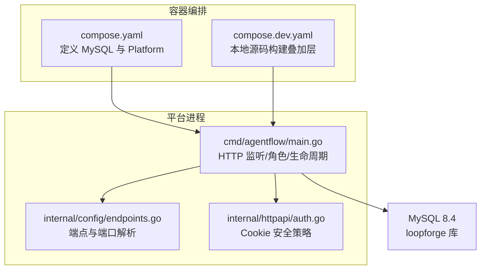
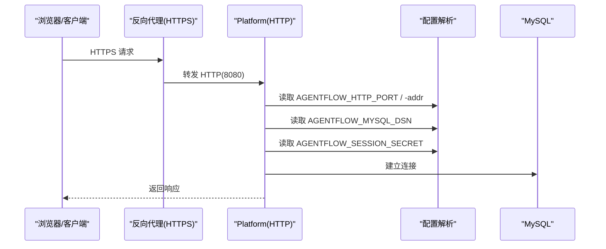
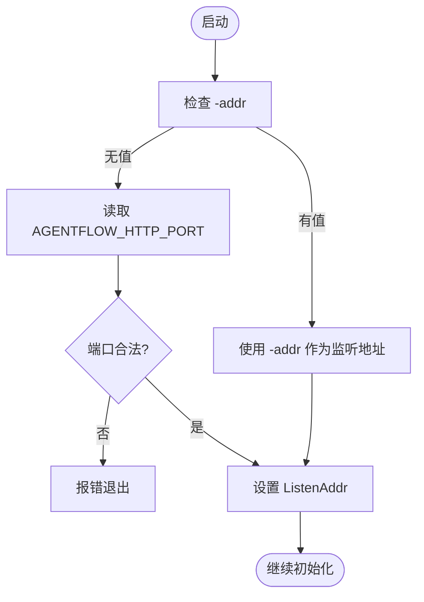
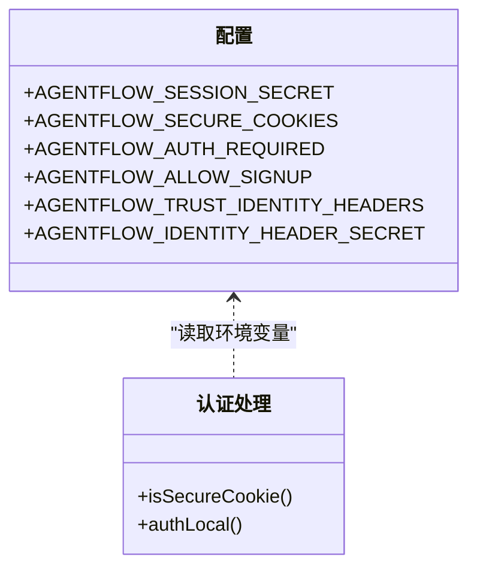
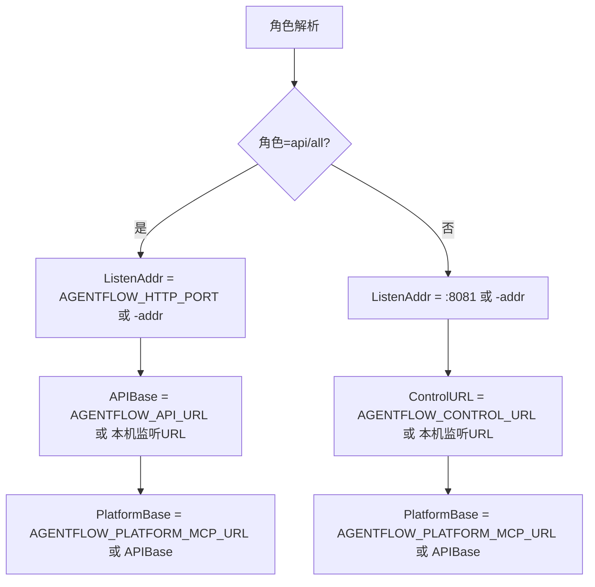
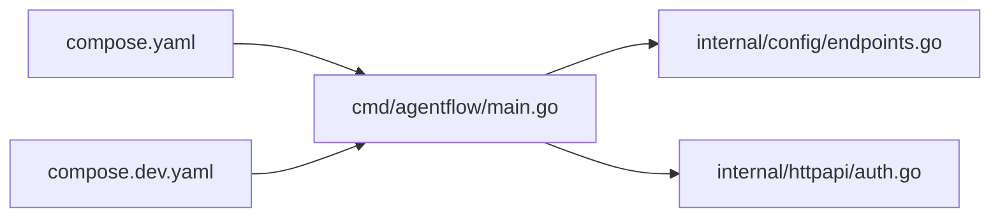

# 高级配置

<cite>
**本文引用的文件**   
- [README.md](file://README.md)
- [docs/deployment.md](file://docs/deployment.md)
- [internal/config/endpoints.go](file://internal/config/endpoints.go)
- [cmd/agentflow/main.go](file://cmd/agentflow/main.go)
- [compose.yaml](file://compose.yaml)
- [compose.dev.yaml](file://compose.dev.yaml)
- [scripts/configure.sh](file://scripts/configure.sh)
- [internal/httpapi/auth.go](file://internal/httpapi/auth.go)
</cite>

## 目录
1. [简介](#简介)
2. [项目结构](#项目结构)
3. [核心组件](#核心组件)
4. [架构总览](#架构总览)
5. [详细组件分析](#详细组件分析)
6. [依赖关系分析](#依赖关系分析)
7. [性能调优](#性能调优)
8. [反向代理与 HTTPS](#反向代理与-https)
9. [集群部署与负载均衡](#集群部署与负载均衡)
10. [故障排查](#故障排查)
11. [结论](#结论)

## 简介
本高级配置文档聚焦 LoopForge 平台的运行参数与环境配置，覆盖 HTTP 端口、数据库连接字符串、会话安全、不同部署模式差异、反向代理与 HTTPS、性能调优以及集群与负载均衡要点。内容基于源码与部署说明整理，便于在开发、测试与生产环境中进行一致且安全的配置。

## 项目结构
LoopForge 的运行时由 Go 主程序、MySQL 数据库、可选的执行器（Runner）和沙箱环境组成；Compose 编排了平台服务与数据库，环境变量集中管理配置项。

图表来源
- [compose.yaml:1-71](file://compose.yaml#L1-L71)
- [compose.dev.yaml:1-14](file://compose.dev.yaml#L1-L14)
- [cmd/agentflow/main.go:77-180](file://cmd/agentflow/main.go#L77-L180)
- [internal/config/endpoints.go:14-70](file://internal/config/endpoints.go#L14-L70)
- [internal/httpapi/auth.go:72-77](file://internal/httpapi/auth.go#L72-L77)

章节来源
- [compose.yaml:1-71](file://compose.yaml#L1-L71)
- [compose.dev.yaml:1-14](file://compose.dev.yaml#L1-L14)
- [cmd/agentflow/main.go:77-180](file://cmd/agentflow/main.go#L77-L180)
- [internal/config/endpoints.go:14-70](file://internal/config/endpoints.go#L14-L70)
- [internal/httpapi/auth.go:72-77](file://internal/httpapi/auth.go#L72-L77)

## 核心组件
- HTTP 监听与端口：通过命令行参数 `-addr` 或环境变量 `AGENTFLOW_HTTP_PORT` 控制；默认 API 端口为 8080，Compose 对外映射到 `AGENTFLOW_HTTP_PORT`（默认 8090）。
- 数据库连接：使用 `AGENTFLOW_MYSQL_DSN` 指定 MySQL DSN；安装脚本会生成并写入 `.env`。
- 会话与安全：`AGENTFLOW_SESSION_SECRET` 用于签名 Cookie；`AGENTFLOW_SECURE_COOKIES` 控制是否启用 Secure Cookie；支持网关信任头部登录。
- 角色与端点：`AGENTFLOW_ROLE` 决定 api/worker/all；Worker 默认监听 8081，API 默认 8080；平台 MCP URL、控制 URL、工作器回退 URL 等由环境变量组合。
- 预览与工具网关：Agent Tool Gateway 与 OTLP Collector Base 默认跟随 API Base，可被显式覆盖。

章节来源
- [cmd/agentflow/main.go:81-94](file://cmd/agentflow/main.go#L81-L94)
- [cmd/agentflow/main.go:107-112](file://cmd/agentflow/main.go#L107-L112)
- [internal/config/endpoints.go:39-70](file://internal/config/endpoints.go#L39-L70)
- [compose.yaml:25-40](file://compose.yaml#L25-L40)
- [scripts/configure.sh:16-20](file://scripts/configure.sh#L16-L20)

## 架构总览
下图展示从外部请求到平台内部各组件的配置路径：反向代理将流量转发至平台 HTTP 端口，平台根据环境变量解析监听地址、数据库连接、会话密钥与工作器通信端点。

图表来源
- [cmd/agentflow/main.go:175-180](file://cmd/agentflow/main.go#L175-L180)
- [internal/config/endpoints.go:72-80](file://internal/config/endpoints.go#L72-L80)
- [compose.yaml:25-30](file://compose.yaml#L25-L30)

## 详细组件分析

### HTTP 端口与监听地址
- 优先级：命令行 `-addr` 优先于 `AGENTFLOW_HTTP_PORT`。
- Compose 对外暴露：`${LOOPFORGE_BIND:-0.0.0.0}:${AGENTFLOW_HTTP_PORT:-8090}:8080`。
- 默认值：内部 API 端口 8080；Worker 默认 8081。
- 校验：非数字或超出范围会报错。

图表来源
- [cmd/agentflow/main.go:81-89](file://cmd/agentflow/main.go#L81-L89)
- [internal/config/endpoints.go:72-80](file://internal/config/endpoints.go#L72-L80)
- [compose.yaml:25-29](file://compose.yaml#L25-L29)

章节来源
- [cmd/agentflow/main.go:81-89](file://cmd/agentflow/main.go#L81-L89)
- [internal/config/endpoints.go:72-80](file://internal/config/endpoints.go#L72-L80)
- [compose.yaml:25-29](file://compose.yaml#L25-L29)

### 数据库连接字符串（DSN）
- 变量：`AGENTFLOW_MYSQL_DSN`。
- Compose 注入：`loopforge:${LOOPFORGE_DB_PASSWORD}@tcp(mysql:3306)/loopforge`。
- 安装脚本：自动生成随机密码并写入 `.env`，同时生成 `AGENTFLOW_MYSQL_DSN`。
- 原生部署：可直接指向外部 MySQL；首次连接会自动创建缺失对象，升级时按发布说明单独执行迁移。

章节来源
- [compose.yaml:28-30](file://compose.yaml#L28-L30)
- [scripts/configure.sh:16-20](file://scripts/configure.sh#L16-L20)
- [docs/deployment.md:22-23](file://docs/deployment.md#L22-L23)

### 会话安全与认证
- 会话密钥：`AGENTFLOW_SESSION_SECRET` 必填，用于签名 Cookie。
- Secure Cookie：当 HTTPS 终止于反向代理时，设置 `AGENTFLOW_SECURE_COOKIES=true`。
- 登录开关：`AGENTFLOW_AUTH_REQUIRED` 默认为 true；允许注册可通过 `AGENTFLOW_ALLOW_SIGNUP` 控制。
- 企业网关信任头部：`AGENTFLOW_TRUST_IDENTITY_HEADERS=true`，配合 `AGENTFLOW_IDENTITY_HEADER_SECRET` 实现可信头登录。

图表来源
- [internal/httpapi/auth.go:72-77](file://internal/httpapi/auth.go#L72-L77)
- [cmd/agentflow/main.go:107-112](file://cmd/agentflow/main.go#L107-L112)
- [docs/deployment.md:67-73](file://docs/deployment.md#L67-L73)

章节来源
- [internal/httpapi/auth.go:72-77](file://internal/httpapi/auth.go#L72-L77)
- [cmd/agentflow/main.go:107-112](file://cmd/agentflow/main.go#L107-L112)
- [docs/deployment.md:67-73](file://docs/deployment.md#L67-L73)

### 端点与角色（API/Worker/All）
- 角色：`AGENTFLOW_ROLE` 或 `-role`，取值 api/worker/all。
- Worker 默认监听 8081，并通过 `AGENTFLOW_CONTROL_URL` 接收控制指令；`AGENTFLOW_WORKER_URL` 提供回退地址。
- API 默认监听 8080，`AGENTFLOW_API_URL` 可覆盖 Worker 访问 API 的地址。
- 平台 MCP URL：`AGENTFLOW_PLATFORM_MCP_URL`，沙箱侧可达的平台地址。
- Agent Tool Gateway：`AGENTFLOW_AGENT_TOOL_GATEWAY_URL`，默认跟随 API Base。

图表来源
- [internal/config/endpoints.go:44-70](file://internal/config/endpoints.go#L44-L70)
- [cmd/agentflow/main.go:175-185](file://cmd/agentflow/main.go#L175-L185)

章节来源
- [internal/config/endpoints.go:44-70](file://internal/config/endpoints.go#L44-L70)
- [cmd/agentflow/main.go:175-185](file://cmd/agentflow/main.go#L175-L185)

### 预览与工具网关
- 预览网关：通过 `preview.LoadConfig()` 加载，公开主机可由 `AGENTFLOW_PREVIEW_PUBLIC_URL` 影响。
- 工具网关：默认绑定到进程内环回地址，也可通过 `AGENTFLOW_AGENT_TOOL_GATEWAY_URL` 覆盖。

章节来源
- [cmd/agentflow/main.go:409-417](file://cmd/agentflow/main.go#L409-L417)
- [internal/config/endpoints.go:82-91](file://internal/config/endpoints.go#L82-L91)

## 依赖关系分析
- 入口：`cmd/agentflow/main.go` 负责加载 `.env`、解析参数、初始化引擎、HTTP 服务器与后台任务。
- 配置：`internal/config/endpoints.go` 统一解析端点与端口，供 API/Worker 使用。
- 编排：`compose.yaml` 定义 MySQL 与 Platform 服务，注入数据库 DSN、会话密钥、Cookie 安全标志等。
- 安全：`internal/httpapi/auth.go` 依据环境变量决定是否启用 Secure Cookie 及本地验收登录。

图表来源
- [cmd/agentflow/main.go:77-180](file://cmd/agentflow/main.go#L77-L180)
- [internal/config/endpoints.go:14-70](file://internal/config/endpoints.go#L14-L70)
- [compose.yaml:1-71](file://compose.yaml#L1-L71)
- [compose.dev.yaml:1-14](file://compose.dev.yaml#L1-L14)
- [internal/httpapi/auth.go:72-77](file://internal/httpapi/auth.go#L72-L77)

章节来源
- [cmd/agentflow/main.go:77-180](file://cmd/agentflow/main.go#L77-L180)
- [internal/config/endpoints.go:14-70](file://internal/config/endpoints.go#L14-L70)
- [compose.yaml:1-71](file://compose.yaml#L1-L71)
- [compose.dev.yaml:1-14](file://compose.dev.yaml#L1-L14)
- [internal/httpapi/auth.go:72-77](file://internal/httpapi/auth.go#L72-L77)

## 性能调优
- 并发与执行
  - 工作器并发节点数：`-worker-concurrency`（默认 8），控制同一 Worker 上并行沙箱数量。
  - 运行租约 TTL：`AGENTFLOW_RUN_LEASE_TTL`，控制任务租约过期时间。
  - 优雅关闭超时：`AGENTFLOW_DRAIN_TIMEOUT`，限制停止时的等待时长。
- Git/Docker 操作限速
  - 克隆与构建的停滞与总超时：`AGENTFLOW_GIT_CLONE_STALL_TIMEOUT`、`AGENTFLOW_GIT_CLONE_TIMEOUT`、`AGENTFLOW_DOCKER_BUILD_STALL_TIMEOUT`、`AGENTFLOW_DOCKER_BUILD_TIMEOUT`。
- 日志与观测
  - 日志级别与适配器统计通过遥测列聚合，可在查询中过滤与分析。
- 模型与工具
  - 模型目录与可用模型：`AGENTFLOW_ASSISTANT_MODEL`、`AGENTFLOW_ASSISTANT_MODELS`。
  - 预览公开地址：`AGENTFLOW_PREVIEW_PUBLIC_URL`。

章节来源
- [cmd/agentflow/main.go:83-94](file://cmd/agentflow/main.go#L83-L94)
- [cmd/agentflow/main.go:145-172](file://cmd/agentflow/main.go#L145-L172)
- [cmd/agentflow/main.go:343-353](file://cmd/agentflow/main.go#L343-L353)
- [docs/deployment.md:84-95](file://docs/deployment.md#L84-L95)
- [compose.yaml:39-41](file://compose.yaml#L39-L41)

## 反向代理与 HTTPS
- 绑定与公网地址
  - 监听地址：`LOOPFORGE_BIND`（默认 `0.0.0.0`），仅本地访问可设为 `127.0.0.1`。
  - 打印访问地址：`LOOPFORGE_PUBLIC_URL` 可选，仅改变显示地址。
- 反向代理要求
  - 必须透传 WebSocket 与流式响应。
  - HTTPS 终止于代理时，设置 `AGENTFLOW_SECURE_COOKIES=true`。
- Nginx 示例要点
  - 将 `/` 代理到平台 HTTP 端口（默认 8080）。
  - 开启 WebSocket 支持（`Upgrade`、`Connection`）。
  - 设置 `X-Forwarded-Proto=https` 以便服务端识别 HTTPS。
- Apache 示例要点
  - 使用 `mod_proxy` 与 `mod_proxy_wstunnel` 转发所有路径。
  - 设置 `ProxyPreserveHost On` 与 `X-Forwarded-Proto`。
- HTTPS 证书
  - 若直接在平台启用 TLS，可使用 `-tls-cert` 与 `-tls-key` 参数。
  - 推荐在生产中将 HTTPS 终止放在反向代理，平台保持 HTTP。

章节来源
- [docs/deployment.md:67-73](file://docs/deployment.md#L67-L73)
- [cmd/agentflow/main.go:328-333](file://cmd/agentflow/main.go#L328-L333)

## 集群部署与负载均衡
- 多实例 API
  - 多个 API 实例共享同一个 MySQL 与稳定 `AGENTFLOW_SESSION_SECRET`。
  - GitHub OAuth 设备码流程需要会话亲和（sticky session）以保证 `/api/auth/github/*` 路由在同一实例。
- 控制面与执行面分离
  - 通过 `AGENTFLOW_CONTROL_TOKEN`、`AGENTFLOW_CONTROL_URL`、`AGENTFLOW_WORKER_URL` 分离控制与执行。
  - Worker 默认监听 8081，API 通过 ControlURL 下发中断与检查点命令。
- 云执行器池
  - `AGENTFLOW_CLOUD_RUNNER_LABEL`、`AGENTFLOW_CLOUD_RUNNER_PROJECTS` 配置云执行器标签与项目。
  - `AGENTFLOW_LOCAL_EXECUTION=false` 可将池项目调度到远程 Runner。
- 负载均衡建议
  - 使用支持 WebSocket 的负载均衡器（如 Nginx、HAProxy、云 LB）。
  - 对认证相关路径启用会话亲和。
  - 健康检查指向 `/api/health`。

章节来源
- [docs/deployment.md:128-136](file://docs/deployment.md#L128-L136)
- [docs/deployment.md:176-182](file://docs/deployment.md#L176-L182)
- [cmd/agentflow/main.go:164-170](file://cmd/agentflow/main.go#L164-L170)

## 故障排查
- 无法启动
  - 缺少 `AGENTFLOW_SESSION_SECRET`：启动时会直接报错退出。
  - 端口无效：`AGENTFLOW_HTTP_PORT` 非数字或越界会报错。
- 数据库连接失败
  - 检查 `AGENTFLOW_MYSQL_DSN` 是否正确；确认 MySQL 已就绪且凭据匹配。
- 登录异常
  - 未启用 HTTPS 但启用了 Secure Cookie：需设置 `AGENTFLOW_SECURE_COOKIES=true` 或在代理处正确透传协议。
  - 企业网关信任头部未配置 Secret：启动时会记录警告。
- 执行缓慢
  - 调整 Git/Docker 超时与停滞阈值；检查网络镜像源与代理。
- 多实例会话丢失
  - 确保 GitHub OAuth 路径具备会话亲和；保证 `AGENTFLOW_SESSION_SECRET` 在所有实例一致。

章节来源
- [cmd/agentflow/main.go:107-112](file://cmd/agentflow/main.go#L107-L112)
- [internal/config/endpoints.go:72-80](file://internal/config/endpoints.go#L72-L80)
- [docs/deployment.md:67-73](file://docs/deployment.md#L67-L73)
- [docs/deployment.md:84-95](file://docs/deployment.md#L84-L95)

## 结论
LoopForge 的高级配置围绕环境变量与少量命令行参数展开，重点包括 HTTP 端口、MySQL DSN、会话密钥与安全标志、端点与角色划分。生产部署应通过反向代理终止 HTTPS，并合理设置 Secure Cookie、WebSocket 透传与会话亲和；在多实例与多执行器场景下，明确控制面与执行面边界，结合云执行器池与负载均衡器获得高可用与弹性扩展能力。